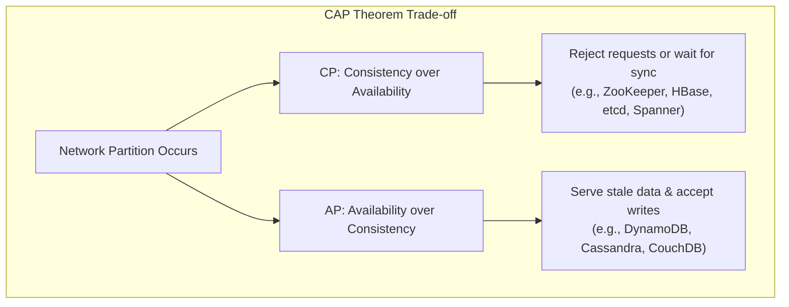
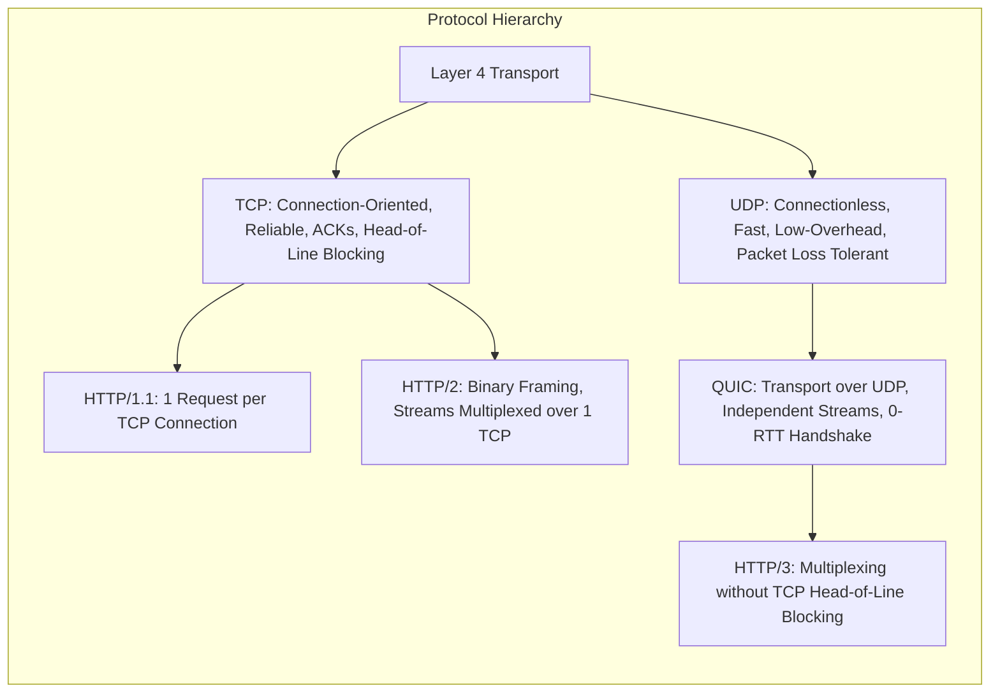
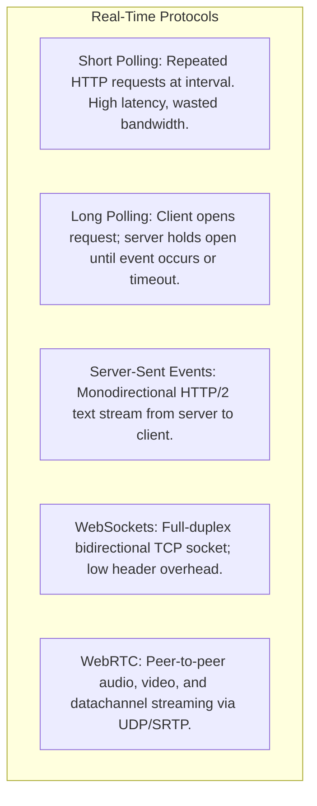
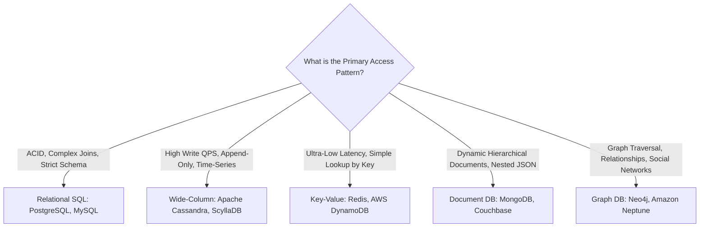
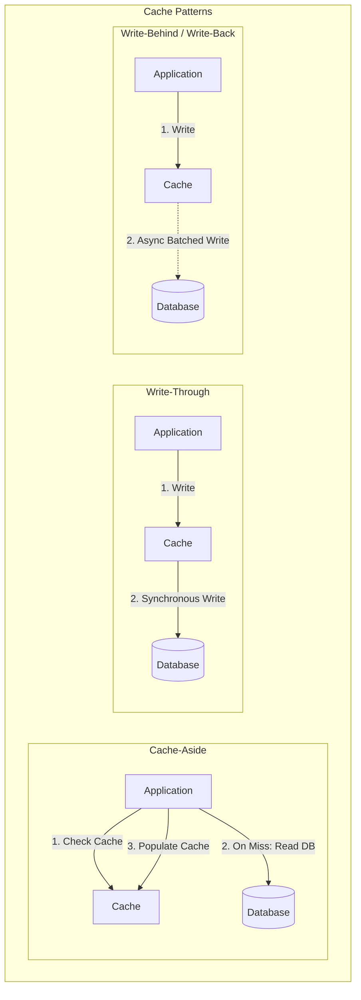
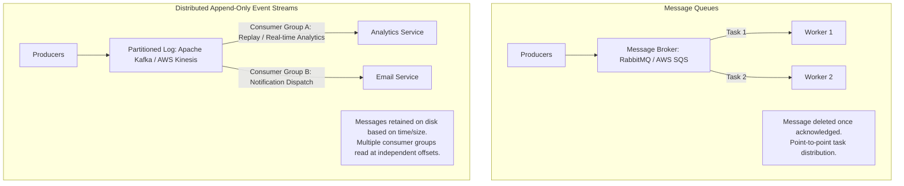
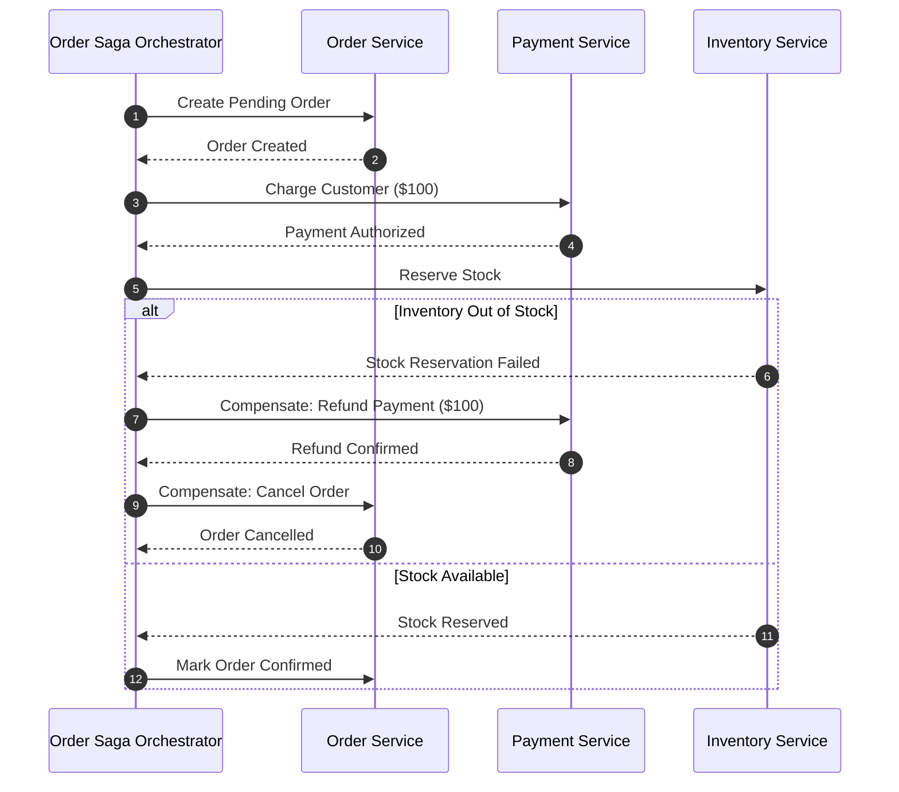
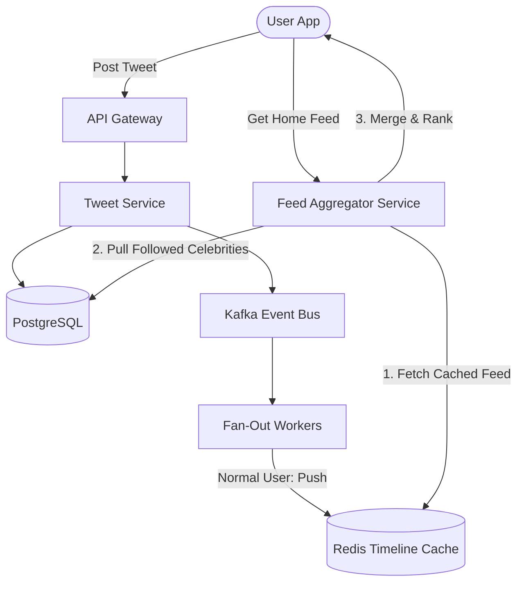
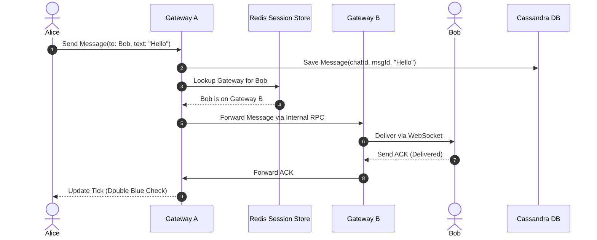

# 🏛️ High-Level Design (HLD) & Distributed Systems Master Guide

A complete, production-grade handbook for cracking System Design interviews at top-tier tech companies (SDE-2, SDE-3, Staff, and Principal Engineer levels).

---

## 📑 Table of Contents

1. [Distributed Systems Fundamentals & Trade-Offs](#1-distributed-systems-fundamentals--trade-offs)
   - [CAP and PACELC Theorems](#11-cap-and-pacelc-theorems)
   - [Consistency Models & Quorum Tunings](#12-consistency-models--quorum-tunings)
   - [Availability, SLAs & Fault Tolerance](#13-availability-slas--fault-tolerance)
   - [Back-of-the-Envelope Estimation Framework (with Worked Example)](#14-back-of-the-envelope-estimation-framework)
2. [Networking, APIs & Edge Infrastructure](#2-networking-apis--edge-infrastructure)
   - [Transport Protocols (TCP, UDP, HTTP/1.1, HTTP/2, HTTP/3 QUIC)](#21-transport-protocols)
   - [API Paradigms (REST, gRPC Protobuf, GraphQL)](#22-api-paradigms)
   - [Real-Time Communication (Polling, SSE, WebSockets, WebRTC)](#23-real-time-communication)
   - [Edge Routing & Load Balancing (Anycast DNS, CDNs, L4 vs L7, API Gateways)](#24-edge-routing--load-balancing)
3. [Data Storage, Internals & Database Scaling](#3-data-storage-internals--database-scaling)
   - [SQL vs. NoSQL Selection Matrix](#31-sql-vs-nosql-selection-matrix)
   - [Storage Engine Internals (B+ Trees vs. LSM Trees & SSTables)](#32-storage-engine-internals)
   - [Replication & Sharding Strategies (Mitigating Hot Keys)](#33-replication--sharding-strategies)
   - [Specialized Indexing (Elasticsearch, S3, Geospatial, Vector DBs)](#34-specialized-indexing)
4. [Caching, Consistent Hashing & Performance](#4-caching-consistent-hashing--performance)
   - [Caching Patterns (Cache-Aside, Read/Write-Through, Write-Behind)](#41-caching-patterns)
   - [Cache Failure Mitigation (Stampede, Penetration, Breakdown)](#42-cache-failure-mitigation)
   - [Eviction Policies & Consistent Hashing with Virtual Nodes](#43-eviction-policies--consistent-hashing)
5. [Asynchronous Messaging & Event Streaming](#5-asynchronous-messaging--event-streaming)
   - [Message Queues vs. Append-Only Log Streams](#51-message-queues-vs-append-only-log-streams)
   - [Delivery Semantics & Consumer Idempotency](#52-delivery-semantics--consumer-idempotency)
   - [Backpressure, DLQs & Exponential Backoff with Jitter](#53-backpressure-dlqs--fault-handling)
6. [Microservices Coordination, Resilience & Observability](#6-microservices-coordination-resilience--observability)
   - [Distributed Transactions (Saga Pattern, Outbox, CDC)](#61-distributed-transactions)
   - [Distributed Coordination & Unique IDs (Snowflake, Locks with Fencing)](#62-distributed-coordination--unique-ids)
   - [Resilience & Rate Limiting (Circuit Breaker, Bulkhead, Token Bucket)](#63-resilience--rate-limiting)
   - [Observability (Metrics, Tracing, Centralized Logging)](#64-observability)
7. [Must-Practice HLD System Archetypes (Detailed Solutions)](#7-must-practice-hld-system-archetypes)
   - [7.1 Social Feeds & Notifications (Twitter/Instagram & Notification Engine)](#71-social-feeds--notifications)
   - [7.2 Real-Time & Stateful Systems (WhatsApp/Slack, Collaborative Docs, Live Leaderboard)](#72-real-time--stateful-systems)
   - [7.3 Location & High-Contention Booking (Uber Ride-Sharing & BookMyShow/Airbnb)](#73-location--high-contention-booking)
   - [7.4 Media & Content Delivery (YouTube/Netflix Streaming & TinyURL/Pastebin)](#74-media--content-delivery)
   - [7.5 FinTech & Core Infrastructure (Payment Gateway, Web Crawler, Search Typeahead, Rate Limiter)](#75-fintech--core-infrastructure)

---

# 1. Distributed Systems Fundamentals & Trade-Offs

### 1.1 CAP and PACELC Theorems

#### The CAP Theorem
In an asynchronous network prone to node or link failures, a distributed data store can guarantee at most **two out of three** properties:
- **Consistency (Linearizability):** Every read receives the most recent write or an error.
- **Availability:** Every non-failing node returns a non-error response for every request (without guarantee of containing the latest write).
- **Partition Tolerance:** The system continues operating despite dropped or delayed network packets between partitions.

> [!IMPORTANT]
> Because network partitions ($P$) are physically inevitable across distributed data centers, systems cannot choose $CA$. Systems must choose between **CP** (preserve consistency by rejecting requests on disconnected partitions) or **AP** (preserve availability by allowing reads/writes on both partitions, accepting divergent data).



#### PACELC Theorem
CAP only explains behavior **during a partition**. PACELC extends CAP to describe behavior **during normal operation**:
- **If Partition ($P$):** Trade-off between **Availability ($A$)** and **Consistency ($C$)**.
- **Else ($E$):** Trade-off between **Latency ($L$)** and **Consistency ($C$)**.

| System Classification | Description | Typical Examples |
|---|---|---|
| **PC/EC** | Consistent on partition; Consistent on normal operation (sacrifices latency for multi-replica sync). | Google Spanner, HBase, Bigtable |
| **PA/EL** | Available on partition; Prefers low latency on normal operation (asynchronous replication). | Apache Cassandra, Amazon DynamoDB, CouchDB |
| **PA/EC** | Available on partition; Consistent on normal operation. | MongoDB (with majority write concern) |
| **PC/EL** | Consistent on partition; Low latency on normal operation. | Megastore |

---

### 1.2 Consistency Models & Quorum Tunings

#### Spectrum of Consistency Models
1. **Linearizability (Strict Consistency):** Global wall-clock order. Once a write completes, all subsequent reads across all nodes must return that value.
2. **Sequential Consistency:** All operations take effect in some sequential order that is seen identically by all processes, preserving per-process program order.
3. **Causal Consistency:** Operations that are causally related must be seen in the same order; concurrent independent operations can be observed in different orders.
4. **Eventual Consistency:** In the absence of new updates, all replicas eventually converge to the same value. Weakest guarantee, highest availability and lowest latency.

#### Quorum Configuration ($R + W > N$)
In leaderless systems (e.g., Cassandra, Amazon Dynamo), consistency is tuned via Quorum parameters:
- $N$ = Total number of replicas storing the partition.
- $W$ = Number of replicas that must acknowledge a write before success.
- $R$ = Number of replicas that must respond to a read request.

```text
Strong Consistency Condition (Overlap Guarantee):
                 R + W > N

Example (N = 3):
- W = 2, R = 2: Strong Consistency (2 + 2 = 4 > 3). Overlap guaranteed.
- W = 3, R = 1: Fast reads, expensive slow writes (write fails if 1 node is down).
- W = 1, R = 1: Ultra-fast reads & writes, Eventual Consistency (1 + 1 = 2 < 3).
```

#### Read Repair & Hinted Handoff
- **Read Repair:** During a quorum read ($R > 1$), if node versions differ, the coordinator returns the latest timestamp value to the client and asynchronously writes the updated value back to the stale replica.
- **Hinted Handoff:** If a replica node is unreachable during a write, the coordinator stores a temporary "hint" locally and delivers the write once the target node recovers.

---

### 1.3 Availability, SLAs & Fault Tolerance

#### Calculating Uptime ("Nines")
| Availability | Downtime per Year | Downtime per Month | Target Workload |
|---|---|---|---|
| **99% ("Two Nines")** | 3.65 days | 7.31 hours | Batch jobs, non-critical internal tools |
| **99.9% ("Three Nines")** | 8.77 hours | 43.8 minutes | Standard web APIs, e-commerce backends |
| **99.99% ("Four Nines")** | 52.6 minutes | 4.38 minutes | Financial transactions, cloud platform control planes |
| **99.999% ("Five Nines")** | 5.26 minutes | 26.3 seconds | Telecoms, critical healthcare, global DNS roots |

#### High Availability Topologies
- **Active-Passive (Failover):** Primary processes all traffic; Standby receives replication stream. On primary heartbeat failure, standby is promoted via automated virtual IP / DNS failover.
- **Active-Active (Multi-Master):** Both instances accept reads and writes concurrently. Requires conflict resolution strategies (Last-Write-Wins, Vector Clocks, or CRDTs).
- **Split-Brain Prevention:** When network partitions sever cluster nodes, both sides might believe the other is dead and promote themselves to leader. Prevented using an **odd number of nodes (e.g., 3, 5)** and requiring a **strict majority quorum** ($\lfloor N/2 \rfloor + 1$) to elect a leader or commit writes.

---

### 1.4 Back-of-the-Envelope Estimation Framework

In an interview, execute capacity estimations in **under 3 minutes** using standard rounding:

#### Quick Conversion Cheat Sheet
- $1 \text{ day} \approx 86,400 \text{ s} \approx 10^5 \text{ seconds}$.
- $1 \text{ Million requests/day} \approx \frac{10^6}{10^5} = 10 \text{ QPS}$.
- $1 \text{ Billion requests/day} \approx \frac{10^9}{10^5} = 10,000 \text{ QPS}$.
- **Storage units:**
  - $1 \text{ KB} = 10^3 \text{ bytes}$
  - $1 \text{ MB} = 10^6 \text{ bytes}$
  - $1 \text{ GB} = 10^9 \text{ bytes}$
  - $1 \text{ TB} = 10^{12} \text{ bytes}$
  - $1 \text{ PB} = 10^{15} \text{ bytes}$

#### The 4-Step Formula
1. **Traffic (QPS):**
   $$\text{Daily Active Users (DAU)} \times \text{Average Requests per User} / 10^5 = \text{Average QPS}$$
   $$\text{Peak QPS} = \text{Average QPS} \times \text{Traffic Burst Multiplier (typically 2 to 5)}$$
2. **Bandwidth:**
   $$\text{Ingress Bandwidth} = \text{Write QPS} \times \text{Payload Size}$$
   $$\text{Egress Bandwidth} = \text{Read QPS} \times \text{Response Size}$$
3. **Storage (5 Years):**
   $$\text{Daily Storage} = \text{Daily Writes} \times \text{Record Size}$$
   $$\text{5-Year Storage} = \text{Daily Storage} \times 365 \times 5 \approx \text{Daily Storage} \times 2000$$
4. **Memory / Cache RAM (80/20 Rule):**
   $$\text{Daily Read Working Set} = \text{Daily Read Volume} \times 0.20$$
   $$\text{RAM Needed} = \text{Daily Read Working Set} \times \text{Retention Window}$$

#### 🎯 Worked Example: Photo Sharing Service (100M DAU)
- **Assumptions:** 100M DAU, each user views 20 photos/day, uploads 1 photo/day (average photo size = 200 KB, metadata = 500 bytes).
1. **Traffic:**
   - Write QPS: $\frac{100\text{M} \times 1}{10^5} = 1,000 \text{ write QPS}$ (Peak = $2,000$).
   - Read QPS: $\frac{100\text{M} \times 20}{10^5} = 20,000 \text{ read QPS}$ (Peak = $50,000$).
2. **Bandwidth:**
   - Ingress: $1,000 \times 200 \text{ KB} = 200 \text{ MB/s}$.
   - Egress: $20,000 \times 200 \text{ KB} = 4 \text{ GB/s}$ ($32 \text{ Gbps}$ — requires multi-tier CDN caching).
3. **Storage (5 Years):**
   - Daily Photos: $100\text{M} \times 200 \text{ KB} = 20 \text{ TB/day}$.
   - 5-Year Photos: $20 \text{ TB} \times 2000 = 40 \text{ PB}$ on S3.
   - 5-Year Metadata: $100\text{M} \times 500 \text{ B} \times 2000 = 100 \text{ TB}$ on DB.
4. **Cache RAM:**
   - 20% of daily read volume: $20\% \times (20,000 \text{ QPS} \times 10^5 \text{ s} \times 200 \text{ KB}) = 0.2 \times 400 \text{ TB} = 80 \text{ TB RAM}$ (distributed Redis cluster).

---

# 2. Networking, APIs & Edge Infrastructure

### 2.1 Transport Protocols



- **HTTP/1.1:** Persistent TCP connections with pipelining, but suffers from Head-of-Line (HoL) blocking at the HTTP request level.
- **HTTP/2:** Single TCP connection multiplexes multiple streams simultaneously using binary framing. However, if one packet drops at the TCP level, **all streams stall** (TCP-level HoL blocking).
- **HTTP/3 (QUIC):** Replaces TCP with UDP + QUIC. Streams are independent: if packet $X$ drops, only stream $X$ waits for retransmission; all other streams continue uninterrupted. Enables 0-RTT connection resumption.

---

### 2.2 API Paradigms

| Metric | REST (HTTP/JSON) | gRPC (HTTP/2 / Protobuf) | GraphQL |
|---|---|---|---|
| **Data Format** | JSON (Text) | Protocol Buffers (Compact Binary) | JSON (Text) |
| **Network Efficiency** | Moderate (verbose headers, strings) | Extremely High (binary serialization, compressed) | High (eliminates over/under-fetching) |
| **Streaming** | Request/Response (unidirectional) | Bi-directional streaming native | Subscriptions (over WebSockets) |
| **Typing** | Optional OpenAPI / Swagger | Strict Contract (`.proto` schema) | Strict Schema (SDL) |
| **Best Used For** | Public client-facing APIs, Web CRUD | Internal microservice-to-microservice RPC | Complex mobile frontends querying nested graphs |

---

### 2.3 Real-Time Communication



- **Use SSE:** Stock tickers, live sports scores, flight arrival boards (one-way server-to-client updates).
- **Use WebSockets:** Chat messaging, multiplayer games, collaborative editing (two-way low-latency messaging).
- **Use WebRTC:** 1-on-1 video calls, voice chat, peer-to-peer file sharing.

---

### 2.4 Edge Routing & Load Balancing

#### Layer 4 vs. Layer 7 Load Balancer
- **L4 Load Balancer (Transport Level - IP & Port):**
  - Examines TCP/UDP headers without decrypting or parsing payloads.
  - Extremely fast ($>1\text{M}$ connections/sec); examples: AWS NLB, Linux Virtual Server (IPVS), HAProxy in TCP mode.
- **L7 Load Balancer (Application Level - HTTP/HTTPS):**
  - Terminates TLS, inspects HTTP paths, headers, cookies, and tokens.
  - Can route `/api/v1/checkout` to Service A and `/api/v1/feed` to Service B. Examples: Envoy, Nginx, AWS ALB.

#### Edge Architecture Flow
```text
Client ──> Anycast DNS ──> Cloudflare Edge / CDN (Static Assets & WAF)
                              │
                              ▼
                       L4 NLB (TCP Throttling & DDoS Absorption)
                              │
                              ▼
                       L7 Reverse Proxy / API Gateway (Envoy / Kong)
                       [Auth, Rate Limiting, Path Routing, SSL Offloading]
                              │
             ┌────────────────┼────────────────┐
             ▼                ▼                ▼
     [User Service]   [Order Service]   [Payment Service]
```

---

# 3. Data Storage, Internals & Database Scaling

### 3.1 SQL vs. NoSQL Selection Matrix



---

### 3.2 Storage Engine Internals

#### B+ Tree (Read-Optimized Engines - PostgreSQL, MySQL InnoDB)
- **Structure:** Balanced $M$-way search tree stored on disk in fixed-size blocks (pages, e.g., 16 KB).
- **Properties:** All leaf nodes are linked sequentially at the same bottom depth. Excellent $O(\log_M N)$ random lookups and efficient sequential range scans.
- **Write Cost:** Updating a row requires finding its leaf page and performing an in-place write. May trigger disk page splits, making random writes heavy on disk I/O.

#### LSM Tree (Log-Structured Merge Tree - Write-Optimized Engines: Cassandra, RocksDB)
- **Structure:**
  1. **MemTable:** In-memory sorted write buffer (backed by a Red-Black tree or SkipList). All `INSERT` and `UPDATE` operations write here, along with an append-only Write-Ahead Log (WAL) on disk for durability.
  2. **SSTables (Sorted String Tables):** When MemTable fills, it is flushed to disk as an immutable SSTable file sorted by key.
  3. **Bloom Filters:** In-memory probabilistic bit array checked prior to reading SSTables. Instantly rules out keys that do not exist, preventing useless disk seeks.
  4. **Compaction:** Background threads merge and deduplicate multiple SSTables, purging tombstones (deleted rows).
- **Trade-off:** High write throughput without random disk I/O, at the cost of read amplification (must check MemTable + multiple SSTables) and write amplification during compaction.

---

### 3.3 Replication & Sharding Strategies

#### Replication Models
1. **Single-Leader (Primary-Replica):** All writes go to Leader; Leader replicates to Read Replicas. Stale read risk if replication lag occurs.
2. **Multi-Leader (Active-Active):** Multiple regions accept writes. Requires conflict resolution (CRDTs or Last-Write-Wins).
3. **Leaderless (Dynamo-Style):** Quorum reads and writes ($R + W > N$).

#### Sharding Techniques & Hot Key Mitigation
- **Range-Based Sharding:** Shard keys split by contiguous intervals. Easy range queries, but causes hot spots if data is sequentially incrementing.
- **Hash-Based Sharding:** $\text{ShardID} = \text{hash}(\text{key}) \pmod N$. Distributes traffic uniformly, but breaks range scans.
- **Hot Key Salt Mitigation:** When a celebrity user receives millions of concurrent writes/reads, append random salt to the key:
  $$\text{salted\_key} = \text{userId} + \text{"\_"} + \text{random}(1, 20)$$
  Writes distribute evenly across 20 shards. Reads query all 20 partitions and aggregate the results.

---

### 3.4 Specialized Indexing

| Index Type | Engine | Mechanism | Ideal Use Case |
|---|---|---|---|
| **Inverted Index** | Elasticsearch, Solr | Maps terms to a posting list of Document IDs | Full-text search, autocomplete, log analytics |
| **Geospatial (Geohash / H3 / QuadTree)** | Redis GEO, Google S2, PostGIS | Discretizes 2D coordinates into hierarchical spatial buckets | Uber driver lookup, nearby restaurant search |
| **Vector Index (HNSW / IVF)** | Milvus, Pinecone, pgvector | Hierarchical Navigable Small World graphs over high-dimensional embeddings | Semantic AI search, recommendation engines |
| **Blob / Object Store** | AWS S3, Google Cloud Storage | Flat key-value namespace optimized for large binary immutable files | Video files, images, database backups |

---

# 4. Caching, Consistent Hashing & Performance

### 4.1 Caching Patterns



- **Cache-Aside:** Application manages cache directly. High resilience (if cache fails, DB serves traffic), but data can become stale until TTL expires.
- **Read-Through / Write-Through:** Cache sits directly in data path; application delegates persistence to the cache layer. Guarantees consistency, but higher write latency.
- **Write-Behind (Write-Back):** Application writes to cache; cache batches writes and updates database asynchronously. High write throughput, but risks data loss if cache crashes before flushing.

---

### 4.2 Cache Failure Mitigation

```text
┌─────────────────────────┬─────────────────────────────────────────────────┬────────────────────────────────────────────────────────┐
│ Vulnerability           │ Phenomenon                                      │ Architectural Mitigation                               │
├─────────────────────────┼─────────────────────────────────────────────────┼────────────────────────────────────────────────────────┤
│ Cache Stampede          │ High-traffic hot key expires; thousands of      │ 1. Mutex / Distributed Lock (single DB query).         │
│ (Thundering Herd)       │ concurrent requests hit DB simultaneously.       │ 2. Probabilistic early recomputation (XFetch).         │
│                         │                                                 │ 3. Add random jitter to key TTLs (e.g., TTL ± 10%).    │
├─────────────────────────┼─────────────────────────────────────────────────┼────────────────────────────────────────────────────────┤
│ Cache Penetration       │ Malicious queries for non-existent IDs bypass   │ 1. Bloom Filter placed in front of cache.              │
│                         │ cache and slam the database directly.            │ 2. Cache null values with short TTL (e.g., 30s).       │
├─────────────────────────┼─────────────────────────────────────────────────┼────────────────────────────────────────────────────────┤
│ Cache Breakdown         │ Hot spot key expires right as viral traffic hits│ Pre-warm cache; background daemon asynchronously       │
│                         │ the platform.                                   │ refreshes key before expiry.                           │
└─────────────────────────┴─────────────────────────────────────────────────┴────────────────────────────────────────────────────────┘
```

---

### 4.3 Eviction Policies & Consistent Hashing

#### Consistent Hashing with Virtual Nodes
Standard modulo hashing ($\text{node} = \text{hash}(\text{key}) \pmod N$) forces remapping of nearly **all keys** when a node is added or removed.

**Consistent Hashing:** Maps both cache nodes and data keys onto a circular ring ($0$ to $2^{32}-1$). A key is assigned to the first node encountered moving clockwise.
- **Node Join / Leave:** Only $K/N$ keys need migration on average ($K$ = total keys, $N$ = number of nodes).
- **Virtual Nodes:** To prevent uneven data distribution (data skew) and hot spots, each physical node is assigned **100–300 virtual tokens** scattered randomly across the ring.

```text
          [Node A_v1] (Token: 0)
              │
    Key 1 ────┼────────┐ Clockwise Walk
              ▼        ▼
          [Node B_v1] (Token: 1,000,000)
                       │
             Key 2 ────┼────────┐
                       ▼        ▼
                   [Node C_v1] (Token: 2,500,000)
```

---

# 5. Asynchronous Messaging & Event Streaming

### 5.1 Message Queues vs. Append-Only Log Streams



---

### 5.2 Delivery Semantics & Consumer Idempotency

1. **At-Most-Once:** Message sent without retry. Lowest overhead, but messages may be lost.
2. **At-Least-Once:** Message resent until consumer acknowledges. Prevents data loss, but network timeouts can result in **duplicate deliveries**.
3. **Exactly-Once:** Requires end-to-end transactional coordination (Kafka 2-Phase Commit). High performance cost.

#### Achieving Safe At-Least-Once via Idempotency
Because true distributed systems rely on at-least-once delivery, consumers **must be designed to be idempotent**.

```sql
CREATE TABLE processed_events (
    idempotency_key VARCHAR(64) PRIMARY KEY,
    processed_at TIMESTAMP DEFAULT CURRENT_TIMESTAMP
);

-- In consumer transaction:
BEGIN;
INSERT INTO processed_events (idempotency_key) VALUES (:eventId);
-- If duplicate -> Throws UniqueConstraintViolation -> Rollback and ignore
UPDATE user_balance SET balance = balance + :amount WHERE user_id = :userId;
COMMIT;
```

---

### 5.3 Backpressure, DLQs & Fault Handling

- **Backpressure:** Downstream consumers communicate saturation to upstream producers by blocking queue writes or signaling rate limits, preventing out-of-memory crashes.
- **Dead-Letter Queue (DLQ):** Messages that fail processing after $N$ retry attempts (e.g., malformed JSON payload / poison pills) are routed to a DLQ for inspection without blocking valid messages.
- **Exponential Backoff with Full Jitter:**
  $$T_{\text{sleep}} = \text{random}(0, \min(T_{\text{max}}, T_{\text{base}} \times 2^{\text{attempt}}))$$
  Adding random jitter prevents synchronized retry storms from hitting recovering backend systems.

---

# 6. Microservices Coordination, Resilience & Observability

### 6.1 Distributed Transactions

#### The Saga Pattern (Alternative to Blocking 2PC)
A Saga is a sequence of local microservice transactions where each updates its database and publishes an event triggering the next step. If any step fails, **compensating transactions** undo previous changes in reverse order.

- **Choreography:** Services listen to events and decide next action autonomously. Simple, but hard to trace in complex workflows.
- **Orchestration:** A central Saga Orchestrator service coordinates workflow state and explicitly dispatches execution and compensation commands.



#### Transactional Outbox Pattern with CDC
Eliminates race conditions where a service writes to its database but crashes before publishing its event to Kafka:
1. Write business state and outgoing event into the **same local database transaction** (using an `outbox` table).
2. A Change Data Capture (CDC) tool like **Debezium** tails the database WAL and reliably streams outbox events to Kafka.

---

### 6.2 Distributed Coordination & Unique IDs

#### 64-bit K-Sorted ID Generator (Twitter Snowflake)
Generates unique 64-bit integer IDs without centralized coordination:

```text
 1 bit       41 bits                  10 bits            12 bits
┌─────┬──────────────────────────┬─────────────────┬──────────────────┐
│  0  │ Epoch Milliseconds (69y) │ Machine / DC ID │ Sequence Counter │
└─────┴──────────────────────────┴─────────────────┴──────────────────┘
```
- Fits into standard 64-bit integer (`BIGINT`).
- Naturally sortable by timestamp, ensuring indexed database lookups remain efficient.

#### Distributed Locks & Fencing Tokens
Never rely solely on lock expiration TTLs: a garbage collection pause or network delay can cause a client's lock to expire while it is still writing.
- **Fencing Token Solution:** The lock manager (e.g. ZooKeeper / etcd) increments a monotonically increasing counter with every lock grant. The storage engine validates that write requests carry a token strictly higher than the previously seen token.

---

### 6.3 Resilience & Rate Limiting

#### Circuit Breaker Pattern
Monitors outbound service calls and transitions across three states:
- **Closed:** Traffic flows normally. Failure counter increments on timeouts.
- **Open:** Failure threshold reached (e.g., $>50\%$ errors). Immediately fails fast with fallback response without hitting downstream.
- **Half-Open:** After timeout window, allows probe requests through. If successful, resets to Closed; if failure occurs, returns to Open.

#### Rate Limiting Algorithms
1. **Token Bucket:** Tokens added at fixed rate; bursts allowed up to capacity.
2. **Leaky Bucket:** Constant processing rate; drops requests when buffer overflows.
3. **Sliding Window Counter:** Hybrid algorithm tracking previous and current window counts to prevent boundary double-bursts.

---

### 6.4 Observability

- **Metrics (Prometheus):** Aggregated numerical data over time (counters, gauges, histograms) for system health, CPU, memory, and latency percentiles (P95, P99).
- **Distributed Tracing (OpenTelemetry, Jaeger):** Tracks requests across microservice boundaries using unique `TraceId` and `SpanId` headers passed via W3C Trace Context.
- **Centralized Logging (ELK / OpenSearch):** Structured JSON logs aggregated across containers with searchable tags and correlation IDs.

---

# 7. Must-Practice HLD System Archetypes

---

### 7.1 Social Feeds & Notifications

#### 1. Twitter / Instagram News Feed
- **Problem Statement:** Design a scalable timeline feed supporting post creation, follower relationships, and home timeline generation for 500M users.
- **Architectural Bottleneck (Celebrity Problem):**
  - **Fan-Out on Write (Push):** When User A posts, write Tweet ID to the Redis timeline lists of all followers. Fast reads ($O(1)$), but when a celebrity with 100M followers tweets, the system must perform 100M Redis writes (fan-out storm).
  - **Fan-Out on Read (Pull):** When User A opens their feed, fetch recent tweets from everyone they follow and merge-sort. Slow reads ($O(N)$ network calls).
- **Solution (Hybrid Architecture):**
  - **Regular Users ($<50,000$ followers):** Fan-out on write (push to followers' Redis timelines).
  - **Celebrity Users ($>50,000$ followers):** Fan-out on read (do not push). When a user requests their feed, fetch the celebrity's tweets and merge them into the cached timeline in memory.
- **Architecture Diagram:**


#### 2. Scalable Notification System
- **Problem Statement:** Dispatch real-time notifications across Push (APNs, FCM), SMS (Twilio), and Email (SendGrid) at 100M notifications/day.
- **Key Solution Points:**
  - **Priority Queuing:** Route OTPs and security alerts to a High-Priority Kafka partition with dedicated workers; route marketing blasts to Low-Priority queues.
  - **User Preference & Rate Limiting:** Enforce user notification settings (Do Not Disturb windows, frequency caps).
  - **Third-Party Provider Fallback:** Wrap external vendor SDKs with Circuit Breakers; fallback from Twilio to AWS SNS if delivery latency spikes.

---

### 7.2 Real-Time & Stateful Systems

#### 1. WhatsApp / Slack Chat System
- **Problem Statement:** Real-time 1-on-1 and group messaging with delivery receipts (Sent, Delivered, Read), presence indicators, and offline sync.
- **Key Architectural Components:**
  - **WebSocket Gateway Pool:** Maintains persistent, bi-directional TCP connections with active mobile/desktop clients.
  - **Session Registry (Redis):** Stores `UserId -> GatewayServerId` mapping to route incoming messages directly to the server holding the recipient's open socket.
  - **Message Storage (Apache Cassandra):** Wide-column store partitioned by `chat_id`, clustered by `message_id` (Snowflake ID) for high write throughput and chronological range queries.
  - **Group Messaging:** Handled via Kafka partitioned by `groupId`; workers fan out messages to active member gateways.


#### 2. Collaborative Documents (Google Docs / Notion)
- **Problem Statement:** Multiple concurrent users editing the same rich text document in real time without conflicting overwrites.
- **Mechanisms:**
  - **Operational Transformation (OT):** Used by Google Docs. A central server acts as the single source of truth, transforming incoming insert/delete operation offsets against concurrent edits.
  - **Conflict-free Replicated Data Types (CRDTs):** Used by Figma and Notion. Mathematically guaranteed eventual convergence without a centralized ordering server. Characters assigned unique fractional positional identifiers.

#### 3. Real-Time Leaderboard
- **Problem Statement:** Real-time game ranking system tracking 10M players, handling 50,000 score updates/sec, displaying Top-100 and surrounding ranks.
- **Solution (Redis Sorted Sets):**
  - **Update Score:** `ZINCRBY leaderboard:global 50 "user_123"` ($O(\log N)$).
  - **Get Top-100:** `ZREVRANGE leaderboard:global 0 99 WITHSCORES` ($O(\log N + K)$).
  - **Get User Rank:** `ZREVRANK leaderboard:global "user_123"` ($O(\log N)$).
  - **Partitioning for Scale:** Shard leaderboards by country or game mode; for global aggregation, maintain tiered buckets or read replicas.

---

### 7.3 Location & High-Contention Booking

#### 1. Uber / Lyft Ride-Sharing System
- **Problem Statement:** Real-time driver location tracking, spatial matching within radius $R$, surge pricing, and ETA calculation.
- **Key Solutions:**
  - **Geospatial Indexing:** Divide the globe into hierarchical spatial tiles using **Google S2** (Hilbert curve) or **Uber H3** (hexagonal grid).
  - **Location Ingestion:** Drivers stream GPS coordinates every 4 seconds over WebSockets. Ingestion workers update the driver's current H3 cell in Redis GEO / in-memory spatial caches.
  - **Driver Dispatch:** Given rider location, convert coordinates to H3 Cell ID, query adjacent ring cells, filter available drivers, and dispatch offers using Dijkstra road network ETA.
```mermaid
flowchart TD
    Driver([Driver App]) -->|GPS Ping (every 4s)| WS[WebSocket Gateway]
    WS --> LocationSvc[Location Ingestion Service]
    LocationSvc --> RedisGeo[(Redis In-Memory Spatial Index: H3/S2)]
    Rider([Rider App]) -->|Request Ride| DispatchSvc[Dispatch Matcher]
    DispatchSvc -->|Query Nearby H3 Hexagons| RedisGeo
    DispatchSvc --> SurgeSvc[Surge Pricing Engine]
    DispatchSvc -->|Offer Trip| Driver
```

#### 2. BookMyShow / Flash Sale Booking
- **Problem Statement:** Thousands of concurrent users attempting to book the exact same high-demand concert seats simultaneously. Prevent double-booking.
- **Solution:**
  - **Two-Phase Reservation with TTL:**
    1. **Temporary Seat Lock:** Atomically acquire a lock on the seat in Redis with a 10-minute expiration:
       `SET show:101:seat:A1 user_456 NX EX 600`
    2. **Payment Processing:** If lock acquired, proceed to payment gateway.
    3. **Final Booking:** Inside database transaction, update DB with Optimistic Concurrency Control (`version` column) or `SELECT ... FOR UPDATE` row lock:
       ```sql
       UPDATE show_seats SET status = 'BOOKED', version = version + 1
       WHERE show_id = :showId AND seat_id = :seatId AND status = 'LOCKED' AND version = :version;
       ```
    4. **Timeout Handling:** If payment fails or TTL expires, Redis key naturally expires, freeing the seat for other users.

---

### 7.4 Media & Content Delivery

#### 1. YouTube / Netflix Video Streaming
- **Problem Statement:** Ingest high-definition video uploads, transcode into multiple resolutions, and deliver globally with minimal buffering.
- **Solution Architecture:**
  - **Upload Pipeline:** Client requests presigned S3 URL; performs chunked resumable upload.
  - **Transcoding Pipeline:** S3 upload triggers an event to Kafka. Distributed transcoding workers (using FFmpeg) execute a Directed Acyclic Graph (DAG) converting raw video into multiple bitrates (4K, 1080p, 720p, 480p) across **HLS** (`.m3u8` master manifest + `.ts` segments) and **MPEG-DASH** formats.
  - **Streaming Delivery:** Player dynamically switches streams based on client network bandwidth (**Adaptive Bitrate Streaming / ABR**). Media segments cached at regional ISP CDN edge points.


#### 2. TinyURL / Pastebin (High-Read Services)
- **Problem Statement:** Shorten URLs and store long-form text pastes with configurable expiry. System is read-heavy ($100:1$ read-to-write ratio).
- **Solution:**
  - **64-bit ID Generation:** Twitter Snowflake generates a unique 64-bit integer.
  - **Base62 Encoding:** Convert 64-bit integer into Base62 (`[0-9a-zA-Z]`), producing a 7-character alias (e.g., $62^7 \approx 3.5 \text{ Trillion}$ unique URLs).
  - **Caching:** Cache top 20% most accessed URLs in Redis; on lookup, return HTTP `302 Found` (preserves analytics tracking) or `301 Moved Permanently` (browser caches redirect).
  - **Pastebin Storage:** Metadata in PostgreSQL/MongoDB; paste payload ($>1\text{MB}$) stored as immutable blob in S3 with presigned read URLs.

---

### 7.5 FinTech & Core Infrastructure

#### 1. Payment Gateway & Digital Wallet
- **Problem Statement:** Process monetary transfers between user accounts with strict ACID guarantees, zero money loss, and auditability.
- **Key Solutions:**
  - **Double-Entry Bookkeeping:** Money is never created or destroyed. Every transaction consists of balanced debit and credit entries across ledger accounts:
    $$\sum \text{Debits} - \sum \text{Credits} = 0$$
  - **Idempotency Key:** Client sends unique `Idempotency-Key` header with every checkout request. Payment service checks idempotency table before initiating charge to prevent double-charging on network timeout retries.
  - **Reconciliation Engine:** Asynchronous nightly batch process compares internal ledger transactions against external bank settlement files to detect discrepancies.

```sql
-- Double-Entry Ledger Schema
CREATE TABLE ledger_entries (
    id VARCHAR(36) PRIMARY KEY,
    transaction_id VARCHAR(36) NOT NULL,
    account_id VARCHAR(36) NOT NULL,
    entry_type VARCHAR(10) NOT NULL, -- DEBIT or CREDIT
    amount DECIMAL(15, 2) NOT NULL,
    created_at TIMESTAMP WITH TIME ZONE DEFAULT CURRENT_TIMESTAMP
);
```

#### 2. Distributed Web Crawler
- **Problem Statement:** Crawl 10 billion web pages, extract content, and feed the search indexer while respecting host politeness.
- **Key Components:**
  - **URL Frontier:** Dual-queue architecture:
    - **Priority Queues:** Rank URLs based on PageRank and update frequency.
    - **Politeness Queues:** Host-based queues enforcing delay between consecutive requests to the same domain (e.g., max 1 req/sec per host).
  - **Deduplication:** In-memory **Bloom Filter** checks if a URL has already been visited; Document SimHash/MinHash detects near-duplicate page content.
  - **Storage:** Raw HTML saved to S3; parsed text and links pushed to Kafka for search indexing.

#### 3. Search Typeahead (Autocomplete)
- **Problem Statement:** Provide real-time top-5 search completions as the user types, with latency $<50\text{ ms}$ at 50,000 QPS.
- **Solution:**
  - **Prefix Trie Structure:** Store search phrases in a Trie. To avoid traversing subtrees at runtime, pre-compute and store the **Top-K search phrases directly inside each node**:
    ```text
    Node ('c'): top = ["cars", "cat", "canvas"]
      └── Node ('a'): top = ["cars", "cat", "canvas"]
            └── Node ('r'): top = ["cars"]
    ```
  - **Offline Aggregation:** Log search queries to Kafka; a nightly Apache Spark/Flink job calculates query frequency and rebuilds the serialized Trie snapshots.
  - **Serving Layer:** In-memory Redis cache storing serialized Top-K results for hot prefixes (`prefix:ca -> ["cars", "cat"]`).

#### 4. Distributed Rate Limiter
- **Problem Statement:** Protect downstream services from abuse by limiting users to $N$ requests per minute across a distributed cluster of microservices.
- **Solution (Redis Lua Script - Sliding Window Counter):**
  Atomic execution in Redis eliminates race conditions without distributed locks:

```lua
-- Redis Lua Script for Sliding Window Rate Limiting
-- KEYS[1]: rate_limit:user_123
-- ARGV[1]: current_timestamp (milliseconds)
-- ARGV[2]: window_size_in_ms (60000)
-- ARGV[3]: max_requests (100)

local key = KEYS[1]
local now = tonumber(ARGV[1])
local window = tonumber(ARGV[2])
local limit = tonumber(ARGV[3])
local clear_before = now - window

-- 1. Remove expired timestamps outside sliding window
redis.call('ZREMRANGEBYSCORE', key, 0, clear_before)

-- 2. Count requests in current window
local current_requests = redis.call('ZCARD', key)

if current_requests < limit then
    -- 3. Add current request timestamp
    redis.call('ZADD', key, now, now)
    redis.call('PEXPIRE', key, window)
    return 1 -- Allowed
else
    return 0 -- Rejected (HTTP 429 Too Many Requests)
end
```
