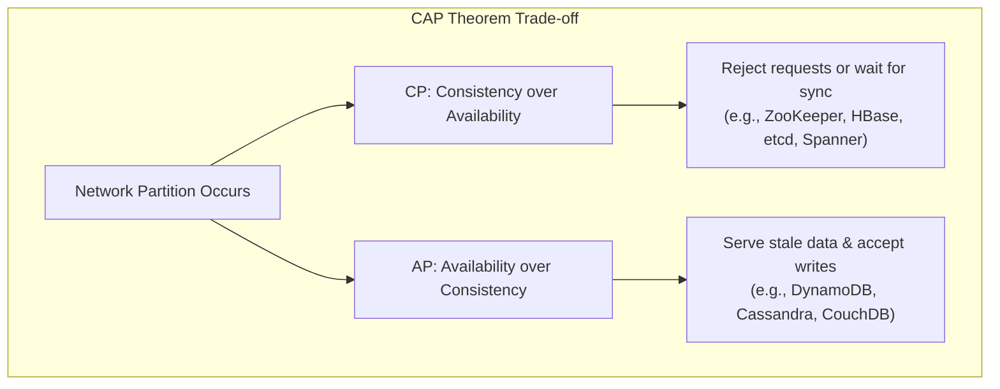
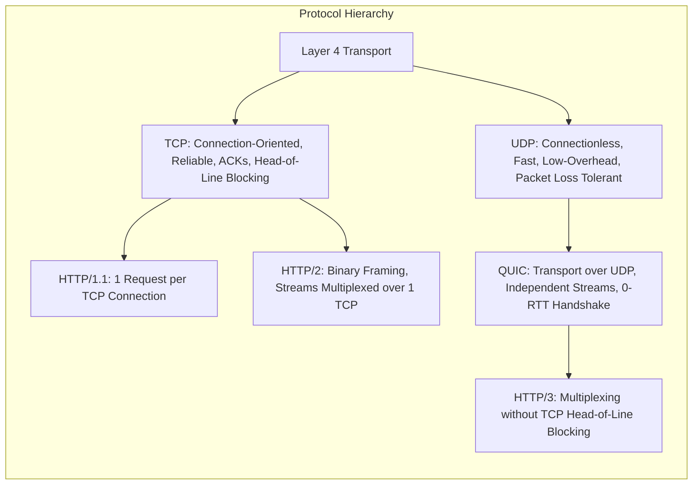
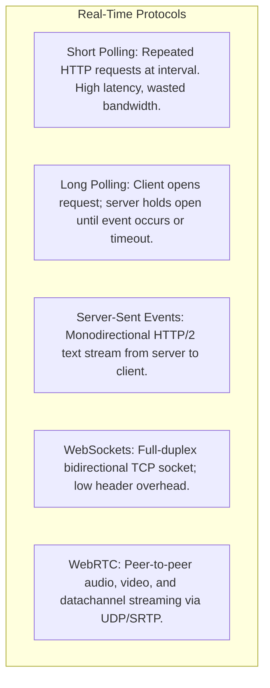
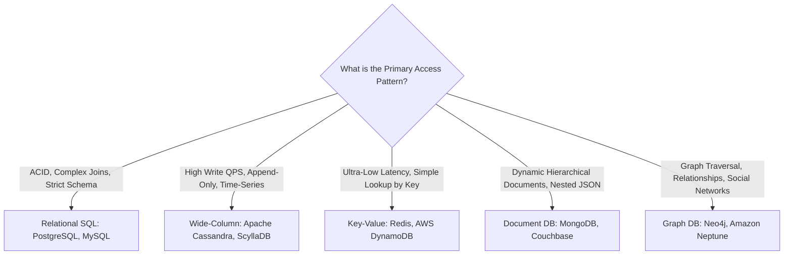
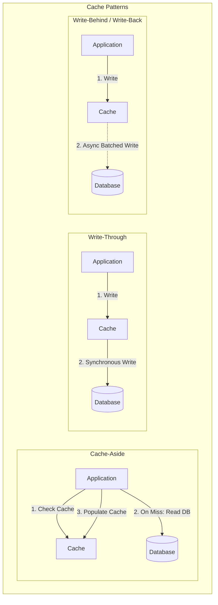
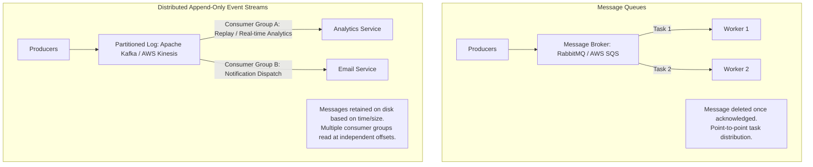
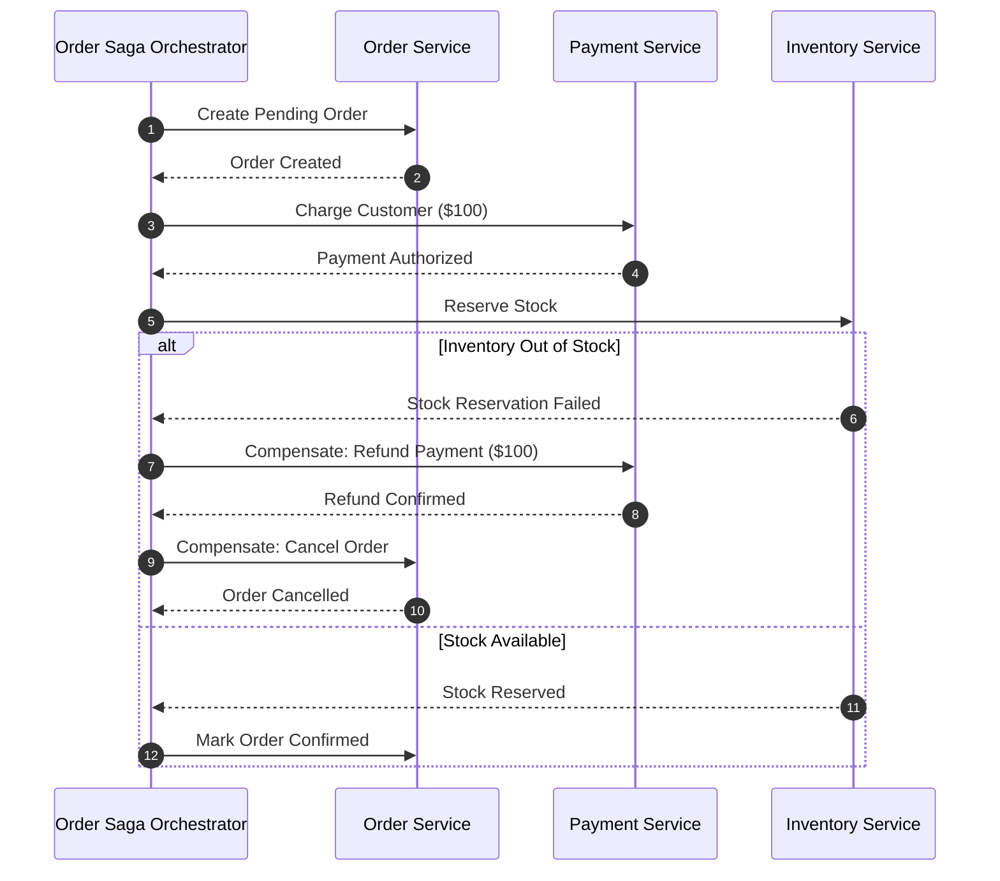

# 🏛️ High-Level Design (HLD) & Distributed Systems Master Guide

A complete, production-grade handbook for cracking System Design interviews at top-tier tech companies (SDE-2, SDE-3, Staff, and Principal Engineer levels).

---

## 📑 Table of Contents

1. [Distributed Systems Fundamentals & Trade-Offs](#1-distributed-systems-fundamentals--trade-offs)
   - [CAP and PACELC Theorems](#11-cap-and-pacelc-theorems)
   - [Consistency Models & Quorum Tunings](#12-consistency-models--quorum-tunings)
   - [Availability, SLAs & Fault Tolerance](#13-availability-slas--fault-tolerance)
   - [Back-of-the-Envelope Estimation Framework](#14-back-of-the-envelope-estimation-framework)
2. [Networking, APIs & Edge Infrastructure](#2-networking-apis--edge-infrastructure)
   - [Transport Protocols (TCP, UDP, HTTP/1.1, HTTP/2, HTTP/3 QUIC)](#21-transport-protocols)
   - [API Paradigms (REST, gRPC Protobuf, GraphQL)](#22-api-paradigms)
   - [Real-Time Communication (Polling, SSE, WebSockets, WebRTC)](#23-real-time-communication)
   - [Edge Routing & Load Balancing (Anycast DNS, CDNs, L4 vs L7, API Gateways)](#24-edge-routing--load-balancing)
3. [Data Storage, Internals & Database Scaling](#3-data-storage-internals--database-scaling)
   - [SQL vs. NoSQL Selection Matrix](#31-sql-vs-nosql-selection-matrix)
   - [Storage Engine Internals (B+ Trees vs. LSM Trees & SSTables)](#32-storage-engine-internals)
   - [Replication & Sharding Strategies](#33-replication--sharding-strategies)
   - [Specialized Indexing (Elasticsearch, S3, Geospatial, Vector DBs)](#34-specialized-indexing)
4. [Caching, Consistent Hashing & Performance](#4-caching-consistent-hashing--performance)
   - [Caching Patterns (Cache-Aside, Read/Write-Through, Write-Behind)](#41-caching-patterns)
   - [Cache Failure Mitigation (Stampede, Penetration, Breakdown)](#42-cache-failure-mitigation)
   - [Eviction Policies & Consistent Hashing with Virtual Nodes](#43-eviction-policies--consistent-hashing)
5. [Asynchronous Messaging & Event Streaming](#5-asynchronous-messaging--event-streaming)
   - [Message Queues vs. Append-Only Log Streams](#51-message-queues-vs-append-only-log-streams)
   - [Delivery Semantics & Consumer Idempotency](#52-delivery-semantics--consumer-idempotency)
   - [Backpressure, DLQs & Fault Handling](#53-backpressure-dlqs--fault-handling)
6. [Microservices Coordination, Resilience & Observability](#6-microservices-coordination-resilience--observability)
   - [Distributed Transactions (Saga Pattern, Outbox, CDC)](#61-distributed-transactions)
   - [Distributed Coordination & Unique IDs (Snowflake, Locks with Fencing)](#62-distributed-coordination--unique-ids)
   - [Resilience & Rate Limiting (Circuit Breaker, Bulkhead, Token Bucket)](#63-resilience--rate-limiting)
   - [Observability (Metrics, Tracing, Centralized Logging)](#64-observability)
7. [Must-Practice HLD System Archetypes](#7-must-practice-hld-system-archetypes)
   - [Social Feeds & Notifications (Twitter/Instagram, Notification Engine)](#71-social-feeds--notifications)
   - [Real-Time & Stateful Systems (WhatsApp/Slack, Collaborative Docs, Leaderboard)](#72-real-time--stateful-systems)
   - [Location & High-Contention Booking (Uber, BookMyShow/Airbnb)](#73-location--high-contention-booking)
   - [Media & Content Delivery (YouTube/Netflix, TinyURL/Pastebin)](#74-media--content-delivery)
   - [FinTech & Core Infrastructure (Payment Gateway & Double-Entry Ledger, Crawler, Search Typeahead)](#75-fintech--core-infrastructure)

---

# 1. Distributed Systems Fundamentals & Trade-Offs

### 1.1 CAP and PACELC Theorems

#### The CAP Theorem
In an asynchronous network prone to node or link failures, a distributed data store can guarantee at most **two out of three** properties:
- **Consistency (Linearizability):** Every read receives the most recent write or an error.
- **Availability:** Every non-failing node returns a non-error response for every request (without guarantee of containing the latest write).
- **Partition Tolerance:** The system continues operating despite dropped or delayed network packets between partitions.

> [!IMPORTANT]
> Because network partitions ($P$) are physically inevitable across distributed data centers, systems cannot choose $CA$. Systems must choose between **CP** (preserve consistency by rejecting requests on disconnected partitions) or **AP** (preserve availability by allowing reads/writes on both partitions, accepting divergent data).



#### PACELC Theorem
CAP only explains behavior **during a partition**. PACELC extends CAP to describe behavior **during normal operation**:
- **If Partition ($P$):** Trade-off between **Availability ($A$)** and **Consistency ($C$)**.
- **Else ($E$):** Trade-off between **Latency ($L$)** and **Consistency ($C$)**.

| System Classification | Description | Typical Examples |
|---|---|---|
| **PC/EC** | Consistent on partition; Consistent on normal operation (sacrifices latency for multi-replica sync). | Bigtable, Spanner, HBase |
| **PA/EL** | Available on partition; Prefers low latency on normal operation (asynchronous replication). | Cassandra, DynamoDB, Riak |
| **PA/EC** | Available on partition; Consistent on normal operation. | MongoDB (configurable read/write concerns) |

---

### 1.2 Consistency Models & Quorum Tunings

#### Spectrum of Consistency Models
1. **Linearizability (Strict Consistency):** Global wall-clock order. Once a write completes, all subsequent reads across all nodes must return that value.
2. **Sequential Consistency:** All operations take effect in some sequential order that is seen identically by all processes, preserving per-process program order.
3. **Causal Consistency:** Operations that are causally related must be seen in the same order; concurrent independent operations can be observed in different orders.
4. **Eventual Consistency:** In the absence of new updates, all replicas eventually converge to the same value. Weakest guarantee, highest availability and lowest latency.

#### Quorum Configuration ($R + W > N$)
In leaderless systems (e.g., Cassandra, Amazon Dynamo), consistency is tuned via Quorum parameters:
- $N$ = Total number of replicas storing the partition.
- $W$ = Number of replicas that must acknowledge a write before success.
- $R$ = Number of replicas that must respond to a read request.

```text
Strong Consistency Condition (Overlap Guarantee):
                 R + W > N

Example (N = 3):
- W = 2, R = 2: Strong Consistency (2 + 2 = 4 > 3).
- W = 3, R = 1: Fast reads, expensive slow writes.
- W = 1, R = 1: Fast reads & writes, Eventual Consistency (1 + 1 = 2 < 3).
```

---

### 1.3 Availability, SLAs & Fault Tolerance

#### Calculating Uptime ("Nines")
| Availability | Downtime per Year | Downtime per Month | Target Workload |
|---|---|---|---|
| **99% ("Two Nines")** | 3.65 days | 7.31 hours | Batch jobs, non-critical internal tools |
| **99.9% ("Three Nines")** | 8.77 hours | 43.8 minutes | Standard web APIs, e-commerce backends |
| **99.99% ("Four Nines")** | 52.6 minutes | 4.38 minutes | Financial transactions, cloud platform control planes |
| **99.999% ("Five Nines")** | 5.26 minutes | 26.3 seconds | Telecoms, critical healthcare, global DNS roots |

#### High Availability Topologies
- **Active-Passive (Failover):** Primary processes all traffic; Standby receives replication stream. On primary heartbeat failure, standby is promoted via automated virtual IP / DNS failover.
- **Active-Active (Multi-Master):** Both instances accept reads and writes concurrently. Requires conflict resolution strategies (Last-Write-Wins, Vector Clocks, or CRDTs).
- **Split-Brain Prevention:** When network partitions sever cluster nodes, both sides might believe the other is dead and promote themselves to leader. Prevented using an **odd number of nodes (e.g., 3, 5)** and requiring a **strict majority quorum** ($\lfloor N/2 \rfloor + 1$) to elect a leader or commit writes.

---

### 1.4 Back-of-the-Envelope Estimation Framework

In an interview, execute capacity estimations in **under 3 minutes** using standard rounding:

#### Quick Conversion Cheat Sheet
- $1 \text{ day} \approx 86,400 \text{ s} \approx 10^5 \text{ seconds}$.
- $1 \text{ Million requests/day} \approx \frac{10^6}{10^5} = 10 \text{ QPS}$.
- $1 \text{ Billion requests/day} \approx \frac{10^9}{10^5} = 10,000 \text{ QPS}$.
- **Storage conversions:**
  - $1 \text{ KB} = 10^3 \text{ bytes}$
  - $1 \text{ MB} = 10^6 \text{ bytes}$
  - $1 \text{ GB} = 10^9 \text{ bytes}$
  - $1 \text{ TB} = 10^{12} \text{ bytes}$
  - $1 \text{ PB} = 10^{15} \text{ bytes}$

#### The 4-Step Formula
1. **Traffic (QPS):**
   $$\text{Daily Active Users (DAU)} \times \text{Average Requests per User} / 10^5 = \text{Average QPS}$$
   $$\text{Peak QPS} = \text{Average QPS} \times \text{Traffic Burst Multiplier (typically 2 to 5)}$$
2. **Bandwidth:**
   $$\text{Ingress Bandwidth} = \text{Write QPS} \times \text{Payload Size}$$
   $$\text{Egress Bandwidth} = \text{Read QPS} \times \text{Response Size}$$
3. **Storage (5 Years):**
   $$\text{Daily Storage} = \text{Daily Writes} \times \text{Record Size}$$
   $$\text{5-Year Storage} = \text{Daily Storage} \times 365 \times 5 \approx \text{Daily Storage} \times 2000$$
4. **Memory / Cache RAM (80/20 Rule):**
   $$\text{Daily Read Working Set} = \text{Daily Read Volume} \times 0.20$$
   $$\text{RAM Needed} = \text{Daily Read Working Set} \times \text{Retention Window}$$

---

# 2. Networking, APIs & Edge Infrastructure

### 2.1 Transport Protocols



- **HTTP/1.1:** Persistent TCP connections with pipelining, but suffers from Head-of-Line (HoL) blocking at the HTTP request level.
- **HTTP/2:** Single TCP connection multiplexes multiple streams simultaneously using binary framing. However, if one packet drops at the TCP level, **all streams stall** (TCP-level HoL blocking).
- **HTTP/3 (QUIC):** Replaces TCP with UDP + QUIC. Streams are independent: if packet $X$ drops, only stream $X$ waits for retransmission; all other streams continue uninterrupted. Enables 0-RTT connection resumption.

---

### 2.2 API Paradigms

| Metric | REST (HTTP/JSON) | gRPC (HTTP/2 / Protobuf) | GraphQL |
|---|---|---|---|
| **Data Format** | JSON (Text) | Protocol Buffers (Compact Binary) | JSON (Text) |
| **Network Efficiency** | Moderate (verbose headers, strings) | Extremely High (binary serialization, compressed) | High (eliminates over/under-fetching) |
| **Streaming** | Request/Response (unidirectional) | Bi-directional streaming native | Subscriptions (over WebSockets) |
| **Typing** | Optional OpenAPI / Swagger | Strict Contract (.proto schema) | Strict Schema (SDL) |
| **Best Used For** | Public client-facing APIs, Web CRUD | Internal microservice-to-microservice RPC | Complex mobile frontends querying nested graphs |

---

### 2.3 Real-Time Communication



- **Use SSE:** Stock tickers, live sports scores, flight arrival boards (one-way server-to-client updates).
- **Use WebSockets:** Chat messaging, multiplayer games, collaborative editing (two-way low-latency messaging).
- **Use WebRTC:** 1-on-1 video calls, voice chat, peer-to-peer file sharing.

---

### 2.4 Edge Routing & Load Balancing

#### Layer 4 vs. Layer 7 Load Balancer
- **L4 Load Balancer (Transport Level - IP & Port):**
  - Examines TCP/UDP headers without decrypting or parsing payloads.
  - Extremely fast ($>1\text{M}$ connections/sec); examples: AWS NLB, Linux Virtual Server (IPVS), HAProxy in TCP mode.
- **L7 Load Balancer (Application Level - HTTP/HTTPS):**
  - Terminates TLS, inspects HTTP paths, headers, cookies, and tokens.
  - Can route `/api/v1/checkout` to Service A and `/api/v1/feed` to Service B. Examples: Envoy, Nginx, AWS ALB.

#### Edge Architecture Flow
```text
Client ──> Anycast DNS ──> Cloudflare Edge / CDN (Static Assets & WAF)
                              │
                              ▼
                       L4 NLB (TCP Throttling & DDoS Absorption)
                              │
                              ▼
                       L7 Reverse Proxy / API Gateway (Envoy / Kong)
                       [Auth, Rate Limiting, Path Routing, SSL Offloading]
                              │
             ┌────────────────┼────────────────┐
             ▼                ▼                ▼
     [User Service]   [Order Service]   [Payment Service]
```

---

# 3. Data Storage, Internals & Database Scaling

### 3.1 SQL vs. NoSQL Selection Matrix



---

### 3.2 Storage Engine Internals

#### B+ Tree (Read-Optimized Engines - PostgreSQL, MySQL InnoDB)
- **Structure:** Balanced $M$-way search tree stored on disk in fixed-size blocks (pages, e.g., 16 KB).
- **Properties:** All leaf nodes are linked sequentially at the same bottom depth. Excellent $O(\log_M N)$ random lookups and efficient sequential range scans.
- **Write Cost:** Updating a row requires finding its leaf page and performing an in-place write. May trigger disk page splits, making random writes heavy on disk I/O.

#### LSM Tree (Log-Structured Merge Tree - Write-Optimized Engines: Cassandra, RocksDB)
- **Structure:**
  1. **MemTable:** In-memory sorted write buffer (backed by a Red-Black tree or SkipList). All `INSERT` and `UPDATE` operations write here, along with an append-only Write-Ahead Log (WAL) on disk for durability.
  2. **SSTables (Sorted String Tables):** When MemTable fills, it is flushed to disk as an immutable SSTable file sorted by key.
  3. **Bloom Filters:** In-memory probabilistic bit array checked prior to reading SSTables. Instantly rules out keys that do not exist, preventing useless disk seeks.
  4. **Compaction:** Background threads merge and deduplicate multiple SSTables, purging tombstones (deleted rows).
- **Trade-off:** High write throughput without random disk I/O, at the cost of read amplification (must check MemTable + multiple SSTables) and write amplification during compaction.

---

### 3.3 Replication & Sharding Strategies

#### Replication Models
1. **Single-Leader (Primary-Replica):**
   - All writes go to the Leader; Leader propagates replication log to Read Replicas (synchronously or asynchronously).
   - Read replicas handle read scaling. Risk of stale reads if replication lag occurs.
2. **Multi-Leader (Active-Active):**
   - Multiple datacenters each have a leader accepting writes. Requires conflict resolution (Last-Write-Wins or CRDTs).
3. **Leaderless (Dynamo-Style):**
   - Client writes to and reads from multiple peer nodes using Quorum reads and writes ($R + W > N$).

#### Sharding Techniques & Hot Key Mitigation
- **Range-Based Sharding:** Shard keys split by contiguous intervals (e.g., User IDs 1–100K $\to$ Shard 1; 100K–200K $\to$ Shard 2). Easy range queries, but causes hot spots if data is sequentially incrementing.
- **Hash-Based Sharding:** Shard key hashed: $\text{ShardID} = \text{hash}(\text{key}) \pmod N$. Distributes traffic uniformly across shards, but breaks sequential range queries.
- **Hot Key Salt Mitigation:** When a celebrity user receives millions of concurrent writes/reads, append random salt to the key:
  $$\text{salted\_key} = \text{userId} + \text{"\_"} + \text{random}(1, 20)$$
  Writes distribute evenly across 20 shards. Reads query all 20 partitions and aggregate the results.

---

### 3.4 Specialized Indexing

| Index Type | Engine | Mechanism | Ideal Use Case |
|---|---|---|---|
| **Inverted Index** | Elasticsearch, Solr | Maps terms to a posting list of Document IDs | Full-text search, autocomplete, log analytics |
| **Geospatial (Geohash / H3 / QuadTree)** | Redis GEO, Google S2, PostGIS | Discretizes 2D coordinates into hierarchical spatial buckets | Uber driver lookup, nearby restaurant search |
| **Vector Index (HNSW / IVF)** | Milvus, Pinecone, pgvector | Hierarchical Navigable Small World graphs over high-dimensional embeddings | Semantic AI search, recommendation engines |
| **Blob / Object Store** | AWS S3, Google Cloud Storage | Flat key-value namespace optimized for large binary immutable files | Video files, images, database backups |

---

# 4. Caching, Consistent Hashing & Performance

### 4.1 Caching Patterns



- **Cache-Aside:** Application manages cache directly. High resilience (if cache fails, DB serves traffic), but data can become stale until TTL expires.
- **Read-Through / Write-Through:** Cache sits directly in data path; application delegates persistence to the cache layer. Guarantees consistency, but higher write latency.
- **Write-Behind (Write-Back):** Application writes to cache; cache batches writes and updates database asynchronously. High write throughput, but risks data loss if cache crashes before flushing.

---

### 4.2 Cache Failure Mitigation

```text
┌─────────────────────────┬─────────────────────────────────────────────────┬────────────────────────────────────────────────────────┐
│ Vulnerability           │ Phenomenon                                      │ Architectural Mitigation                               │
├─────────────────────────┼─────────────────────────────────────────────────┼────────────────────────────────────────────────────────┤
│ Cache Stampede          │ High-traffic hot key expires; thousands of      │ 1. Mutex / Distributed Lock (single DB query).         │
│ (Thundering Herd)       │ concurrent requests hit DB simultaneously.       │ 2. Probabilistic early recomputation (XFetch).         │
│                         │                                                 │ 3. Add random jitter to key TTLs (e.g., TTL ± 10%).    │
├─────────────────────────┼─────────────────────────────────────────────────┼────────────────────────────────────────────────────────┤
│ Cache Penetration       │ Malicious queries for non-existent IDs bypass   │ 1. Bloom Filter placed in front of cache.              │
│                         │ cache and slam the database directly.            │ 2. Cache null values with short TTL (e.g., 30s).       │
├─────────────────────────┼─────────────────────────────────────────────────┼────────────────────────────────────────────────────────┤
│ Cache Breakdown         │ Hot spot key expires right as viral traffic hits│ Pre-warm cache; background daemon asynchronously       │
│                         │ the platform.                                   │ refreshes key before expiry.                           │
└─────────────────────────┴─────────────────────────────────────────────────┴────────────────────────────────────────────────────────┘
```

---

### 4.3 Eviction Policies & Consistent Hashing

#### Cache Eviction Algorithms
- **LRU (Least Recently Used):** Evicts the key that has not been accessed for the longest time (Doubly Linked List + HashMap).
- **LFU (Least Frequently Used):** Evicts the key with the lowest access count (requires frequency buckets and counters).
- **FIFO (First-In, First-Out):** Evicts the oldest created key regardless of usage.

#### Consistent Hashing with Virtual Nodes
Standard modulo hashing ($\text{node} = \text{hash}(\text{key}) \pmod N$) forces remapping of nearly **all keys** when a node is added or removed.

**Consistent Hashing:** Maps both cache nodes and data keys onto a circular ring ($0$ to $2^{32}-1$). A key is assigned to the first node encountered moving clockwise.
- **Node Join / Leave:** Only $K/N$ keys need migration on average ($K$ = total keys, $N$ = number of nodes).
- **Virtual Nodes:** To prevent uneven data distribution (data skew) and hot spots, each physical node is assigned **100–300 virtual tokens** scattered randomly across the ring.

```text
          [Node A_v1] (Token: 0)
              │
    Key 1 ────┼────────┐ Clockwise Walk
              ▼        ▼
          [Node B_v1] (Token: 1,000,000)
                       │
             Key 2 ────┼────────┐
                       ▼        ▼
                   [Node C_v1] (Token: 2,500,000)
```

---

# 5. Asynchronous Messaging & Event Streaming

### 5.1 Message Queues vs. Append-Only Log Streams



---

### 5.2 Delivery Semantics & Consumer Idempotency

1. **At-Most-Once:** Message sent without retry. Lowest overhead, but messages may be lost.
2. **At-Least-Once:** Message resent until consumer acknowledges. Prevents data loss, but network timeouts can result in **duplicate deliveries**.
3. **Exactly-Once:** Requires end-to-end transactional coordination (Kafka 2-Phase Commit). High performance cost.

#### Achieving Safe At-Least-Once via Idempotency
Because true distributed systems rely on at-least-once delivery, consumers **must be designed to be idempotent**.

```sql
-- Pattern 1: Database Unique Constraint Deduplication
CREATE TABLE processed_events (
    idempotency_key VARCHAR(64) PRIMARY KEY,
    processed_at TIMESTAMP DEFAULT CURRENT_TIMESTAMP
);

-- In consumer transaction:
BEGIN;
INSERT INTO processed_events (idempotency_key) VALUES (:eventId);
-- If duplicate -> Throws UniqueConstraintViolation -> Rollback and ignore
UPDATE user_balance SET balance = balance + :amount WHERE user_id = :userId;
COMMIT;
```

---

### 5.3 Backpressure, DLQs & Fault Handling

- **Backpressure:** Downstream consumers communicate saturation to upstream producers by blocking queue writes or signaling rate limits, preventing out-of-memory crashes.
- **Dead-Letter Queue (DLQ):** Messages that fail processing after $N$ retry attempts (e.g., malformed JSON payload / poison pills) are routed to a DLQ for inspection without blocking valid messages.
- **Exponential Backoff with Full Jitter:**
  $$T_{\text{sleep}} = \text{random}(0, \min(T_{\text{max}}, T_{\text{base}} \times 2^{\text{attempt}}))$$
  Adding random jitter prevents synchronized retry storms from hitting recovering backend systems.

---

# 6. Microservices Coordination, Resilience & Observability

### 6.1 Distributed Transactions

#### The Saga Pattern (Alternative to Blocking 2PC)
A Saga is a sequence of local microservice transactions where each updates its database and publishes an event triggering the next step. If any step fails, **compensating transactions** undo previous changes in reverse order.

- **Choreography:** Services listen to events and decide next action autonomously. Simple, but hard to trace in complex workflows.
- **Orchestration:** A central Saga Orchestrator service coordinates workflow state and explicitly dispatches execution and compensation commands.



#### Transactional Outbox Pattern with CDC
Eliminates race conditions where a service writes to its database but crashes before publishing its event to Kafka:
1. Write business state and outgoing event into the **same local database transaction** (using an `outbox` table).
2. A Change Data Capture (CDC) tool like **Debezium** tails the database WAL and reliably streams outbox events to Kafka.

---

### 6.2 Distributed Coordination & Unique IDs

#### 64-bit K-Sorted ID Generator (Twitter Snowflake)
Generates unique 64-bit integer IDs without centralized coordination:

```text
 1 bit       41 bits                  10 bits            12 bits
┌─────┬──────────────────────────┬─────────────────┬──────────────────┐
│  0  │ Epoch Milliseconds (69y) │ Machine / DC ID │ Sequence Counter │
└─────┴──────────────────────────┴─────────────────┴──────────────────┘
```
- Fits into standard 64-bit integer (`BIGINT`).
- Naturally sortable by timestamp, ensuring indexed database lookups remain efficient.

#### Distributed Locks & Fencing Tokens
Never rely solely on lock expiration TTLs: a garbage collection pause or network delay can cause a client's lock to expire while it is still writing.
- **Fencing Token Solution:** The lock manager (e.g. ZooKeeper / etcd) increments a monotonically increasing counter with every lock grant. The storage engine validates that write requests carry a token strictly higher than the previously seen token.

---

### 6.3 Resilience & Rate Limiting

#### Circuit Breaker Pattern
Monitors outbound service calls and transitions across three states:
- **Closed:** Traffic flows normally. Failure counter increments on timeouts.
- **Open:** Failure threshold reached (e.g., $>50\%$ errors). Immediately fails fast with fallback response without hitting downstream.
- **Half-Open:** After timeout window, allows probe requests through. If successful, resets to Closed; if failure occurs, returns to Open.

#### Rate Limiting Algorithms
1. **Token Bucket:** Tokens added at fixed rate; bursts allowed up to capacity.
2. **Leaky Bucket:** Constant processing rate; drops requests when buffer overflows.
3. **Sliding Window Counter:** Hybrid algorithm tracking previous and current window counts to prevent boundary double-bursts.

---

### 6.4 Observability

- **Metrics (Prometheus):** Aggregated numerical data over time (counters, gauges, histograms) for system health, CPU, memory, and latency percentiles (P95, P99).
- **Distributed Tracing (OpenTelemetry, Jaeger):** Tracks requests across microservice boundaries using unique `TraceId` and `SpanId` headers passed via W3C Trace Context.
- **Centralized Logging (ELK / OpenSearch):** Structured JSON logs aggregated across containers with searchable tags and correlation IDs.

---

# 7. Must-Practice HLD System Archetypes

### 7.1 Social Feeds & Notifications

#### Twitter / Instagram News Feed (Hybrid Fan-Out Architecture)
- **Challenge:** Millions of regular users follow celebrities with 100M+ followers.
- **Architecture:**
  - **Regular Users (Fan-Out on Write / Push):** When a user posts, push tweet ID to the timeline Redis cache of all their followers.
  - **Celebrity Users (Fan-Out on Read / Pull):** For users with $>50,000$ followers, do not push to followers' caches. When a follower opens their feed, pull the celebrity's recent tweets and merge them dynamically into the follower's timeline.

#### Scalable Notification System
- **Architecture:** API Gateway $\to$ Notification Orchestrator $\to$ Priority Queue (High: OTP/Verification, Low: Marketing) $\to$ Third-Party Adapters (APNs, FCM, Twilio, SendGrid) with circuit breakers and fallback providers.

---

### 7.2 Real-Time & Stateful Systems

#### WhatsApp / Slack Chat System
- **Architecture:**
  - Clients maintain persistent **WebSocket** connections to a pool of Chat Gateways.
  - User-to-Gateway mapping tracked in a distributed Session Store (Redis).
  - Messages persisted to an append-heavy wide-column store (**Apache Cassandra**).
  - Group chats managed using Kafka partitioned by `groupId`.

#### Collaborative Documents (Google Docs / Notion)
- **Mechanism:** Conflict-free Replicated Data Types (**CRDTs**) or **Operational Transformation (OT)** over WebSockets with version vectors to resolve concurrent edits without locks.

---

### 7.3 Location & High-Contention Booking

#### Uber Ride-Sharing System
- **Architecture:**
  - Drivers stream coordinates every 4 seconds over WebSockets.
  - Ingest service indexes locations into **Google S2** or **Uber H3** hexagonal hierarchical spatial indices stored in in-memory Redis GEO sets.
  - Dispatch engine queries adjacent spatial cells in $O(1)$ time to match nearest drivers using Dijkstra ETA estimates.

#### BookMyShow / Flash Sale System
- **Architecture:**
  - Fine-grained distributed seat locks in Redis with temporary TTL (10 minutes).
  - Pessimistic locking or Optimistic Concurrency Control (`version` check) at DB transaction boundary to prevent double-booking.

---

### 7.4 Media & Content Delivery

#### YouTube / Netflix Video Streaming
- **Architecture:**
  - **Upload Pipeline:** Chunked upload to S3 $\to$ Kafka trigger $\to$ Distributed Transcoding DAG (workers convert video into multiple resolutions: 4K, 1080p, 720p across HLS and MPEG-DASH formats).
  - **Delivery Pipeline:** Adaptive Bitrate Streaming (ABR) served via global multi-tier CDNs caching popular segments at Internet Service Provider (ISP) edge points.

#### TinyURL (Distributed URL Shortener)
- **Architecture:** 64-bit ID generator $\to$ Base62 encoding (`[a-zA-Z0-9]`) producing 7-character aliases. Highly read-heavy ($100:1$ ratio) optimized via multi-layer Redis caching.

---

### 7.5 FinTech & Core Infrastructure

#### Payment Gateway & Digital Wallet
- **Architecture:**
  - **Double-Entry Bookkeeping:** Every monetary transaction consists of equal, opposite debit and credit entries; sum of all accounts remains zero.
  - **Reconciliation Engine:** Asynchronous batch worker comparing internal ledger against external bank settlement files to detect anomalies.

#### Web Crawler
- **Architecture:** URL Frontier (Priority Queue + Host Politeness Queues) $\to$ Fetcher Pool $\to$ HTML Parser $\to$ Bloom Filter for URL Deduplication $\to$ S3 Raw Document Store $\to$ Kafka stream for indexing.

