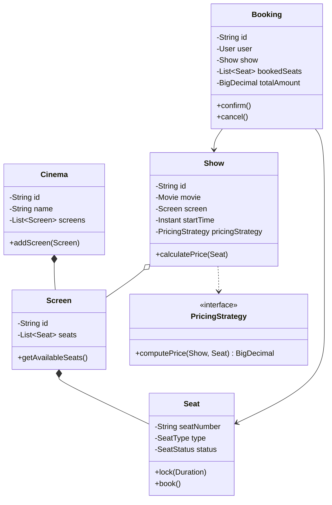
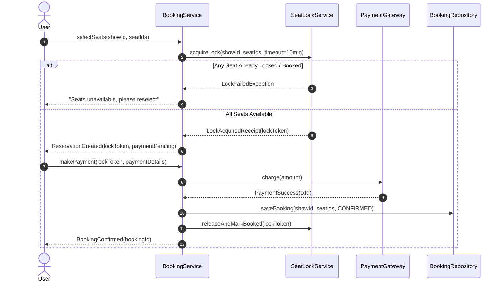
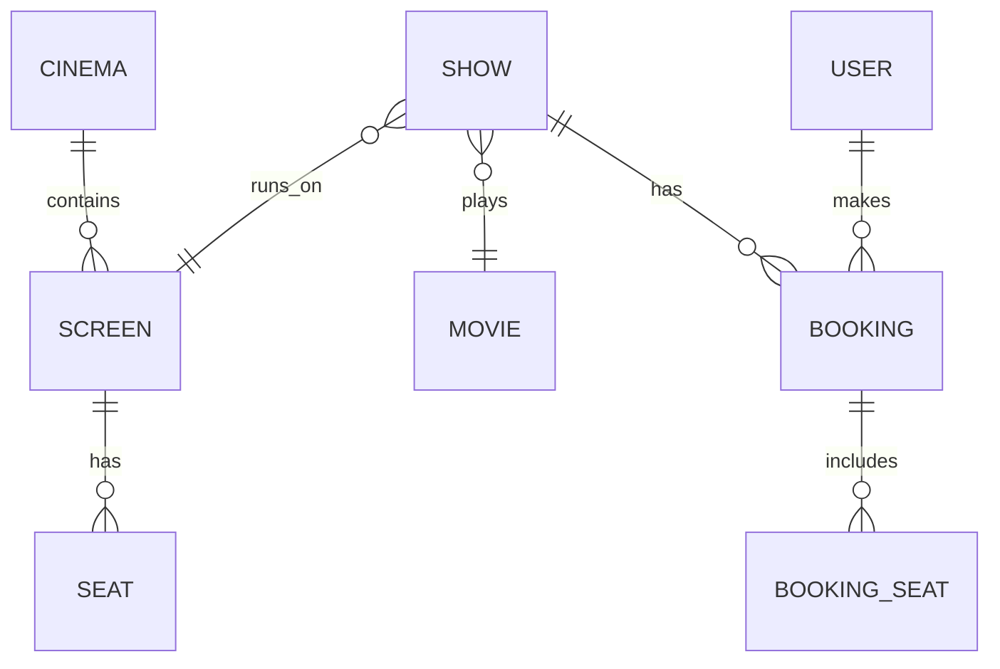

# 📐 Low-Level Design (LLD) & Machine Coding Master Guide

A complete, production-grade guide to mastering Object-Oriented Design, Design Patterns, Concurrency, and Machine Coding for SDE-2, SDE-3, and Staff Engineering interviews.

---

## 📑 Table of Contents

1. [Object-Oriented Modeling & Class Relationships](#1-object-oriented-modeling--class-relationships)
   - [Four OOP Pillars (Runtime Polymorphism & Encapsulation)](#11-four-oop-pillars)
   - [Association, Aggregation, and Composition](#12-association-aggregation-and-composition)
   - [Interfaces vs. Abstract Classes](#13-interfaces-vs-abstract-classes)
   - [Rich Enums in Java](#14-rich-enums-in-java)
   - [UML Essentials: Class & Sequence Diagrams](#15-uml-essentials)
2. [Core Software Design Principles (SOLID, DRY, KISS, YAGNI)](#2-core-software-design-principles)
   - [Single Responsibility Principle (SRP)](#21-single-responsibility-principle-srp)
   - [Open / Closed Principle (OCP)](#22-open--closed-principle-ocp)
   - [Liskov Substitution Principle (LSP)](#23-liskov-substitution-principle-lsp)
   - [Interface Segregation Principle (ISP)](#24-interface-segregation-principle-isp)
   - [Dependency Inversion Principle (DIP)](#25-dependency-inversion-principle-dip)
   - [Pragmatic Pragmatism: DRY, KISS, and YAGNI](#26-dry-kiss-and-yagni)
3. [High-Frequency Design Patterns (Gang of Four)](#3-high-frequency-design-patterns-gang-of-four)
   - [Creational Patterns (Singleton, Factory, Builder)](#31-creational-patterns)
   - [Behavioral Patterns Tier 1 (Strategy, Observer, State)](#32-behavioral-patterns-tier-1)
   - [Behavioral Patterns Tier 2 (Chain of Responsibility, Command)](#33-behavioral-patterns-tier-2)
   - [Structural Patterns (Decorator, Adapter, Facade, Proxy)](#34-structural-patterns)
4. [Concurrency & Thread-Safety (The SDE-2+ Differentiator)](#4-concurrency--thread-safety-the-sde-2-differentiator)
   - [Synchronization Primitives & Trade-offs](#41-synchronization-primitives)
   - [Lock-Free Atomics & CAS Loops](#42-lock-free-atomics--cas-loops)
   - [Concurrent Collections in Practice](#43-concurrent-collections-in-practice)
   - [Fine-Grained Resource-Level Locking](#44-fine-grained-resource-level-locking)
   - [Deadlock & Race Condition Prevention](#45-deadlock--race-condition-prevention)
5. [Machine Coding Architecture & Execution (60–90 Minute Rounds)](#5-machine-coding-architecture--execution-6090-minute-rounds)
   - [Clean Package Structure](#51-clean-package-structure)
   - [In-Memory Indexing for Fast Lookups](#52-in-memory-indexing)
   - [Custom Domain Exceptions & Boundary Validations](#53-custom-domain-exceptions--boundary-validations)
   - [Production-Ready Machine Coding Code Blueprint](#54-complete-machine-coding-template)
6. [Database Schema & API Contract Extensions](#6-database-schema--api-contract-extensions)
   - [Relational Mapping (Class Diagram to 3NF SQL Schema)](#61-relational-mapping)
   - [DB Concurrency: Optimistic vs. Pessimistic Locking](#62-database-concurrency-control)
   - [API Contract Design & Idempotency](#63-api-contract-design)
7. [Must-Practice LLD Case Studies by Category](#7-must-practice-lld-case-studies-by-category)
   - [Booking & Slot Allocation](#71-booking--slot-allocation)
   - [State & Workflow Machines](#72-state--workflow-machines)
   - [Matching, Ledgers & Marketplaces](#73-matching-ledgers--marketplaces)
   - [Board & Turn-Based Games](#74-board--turn-based-games)
   - [Core Backend Infrastructure](#75-core-backend-infrastructure)

---

# 1. Object-Oriented Modeling & Class Relationships

### 1.1 Four OOP Pillars

Interviews for SDE-2+ look beyond elementary textbook definitions (e.g., "polymorphism is shapes drawing circles"). Interviewers assess **runtime polymorphism via interface contracts** and **domain-driven encapsulation** that prevents anemic data models.

#### Encapsulation: Rich Domain Model vs. Anemic Model
An **anemic model** exposes all fields via getters/setters, shifting business invariants into random service classes where rules become scattered and violated. A **rich domain model** bundles mutable state with behavioral methods enforcing invariants.

```java
// ❌ ANEMIC MODEL: Invariants leaked to callers
public class AnemicAccount {
    private BigDecimal balance;
    public BigDecimal getBalance() { return balance; }
    public void setBalance(BigDecimal balance) { this.balance = balance; }
}

// Caller code can corrupt domain state:
// account.setBalance(account.getBalance().subtract(amount)); // Not thread-safe, no validation!

// ✅ RICH DOMAIN MODEL: Encapsulates state + enforces invariant rules
public class BankAccount {
    private final String accountId;
    private BigDecimal balance;
    private final List<Transaction> transactions = new ArrayList<>();

    public BankAccount(String accountId, BigDecimal initialBalance) {
        if (initialBalance.compareTo(BigDecimal.ZERO) < 0) {
            throw new IllegalArgumentException("Initial balance cannot be negative");
        }
        this.accountId = Objects.requireNonNull(accountId, "accountId required");
        this.balance = initialBalance;
    }

    // Domain behavior protecting internal state
    public synchronized void withdraw(BigDecimal amount, String referenceId) {
        Objects.requireNonNull(amount, "Withdrawal amount required");
        if (amount.compareTo(BigDecimal.ZERO) <= 0) {
            throw new IllegalArgumentException("Amount must be positive");
        }
        if (this.balance.compareTo(amount) < 0) {
            throw new InsufficientBalanceException("Balance insufficient for account: " + accountId);
        }
        this.balance = this.balance.subtract(amount);
        this.transactions.add(new Transaction(referenceId, TransactionType.DEBIT, amount, Instant.now()));
    }

    public synchronized BigDecimal getBalance() {
        return this.balance;
    }

    // Defensive copy prevents caller tampering
    public synchronized List<Transaction> getTransactions() {
        return Collections.unmodifiableList(new ArrayList<>(transactions));
    }
}
```

#### Runtime Polymorphism: Decoupled Dispatch
Decouple callers from concrete algorithmic variants by dispatching through an interface:

```java
public interface PaymentProcessor {
    PaymentResult process(PaymentRequest request);
    PaymentMethod getSupportedMethod();
}

public class CardPaymentProcessor implements PaymentProcessor {
    @Override
    public PaymentResult process(PaymentRequest request) {
        return PaymentResult.success("CARD-" + UUID.randomUUID());
    }

    @Override
    public PaymentMethod getSupportedMethod() {
        return PaymentMethod.CREDIT_CARD;
    }
}

public class UpiPaymentProcessor implements PaymentProcessor {
    @Override
    public PaymentResult process(PaymentRequest request) {
        return PaymentResult.success("UPI-" + UUID.randomUUID());
    }

    @Override
    public PaymentMethod getSupportedMethod() {
        return PaymentMethod.UPI;
    }
}
```

---

### 1.2 Association, Aggregation, and Composition

Distinguish object lifecycles and ownership semantics during domain modeling:

| Relationship | Type | Lifecycle Dependency | Example | UML Notation |
|---|---|---|---|---|
| **Association** | "uses-a" | Independent | Passenger and TicketCounter (Passenger queries counter) | `A --> B` |
| **Aggregation** | "has-a" (weak) | Independent; Child outlives Parent | Driver and Vehicle (Vehicle still exists if Driver leaves) | `A o-- B` |
| **Composition** | "owns-a" (strong) | Bound; Child dies with Parent | Order and OrderLineItem (Line item cannot exist without Order) | `A *-- B` |

```java
// 1. Aggregation: Driver "has-a" Vehicle (Driver can be unassigned, vehicle persists)
public class Driver {
    private final String id;
    private Vehicle currentVehicle; // Can be null, changed, or reassigned

    public Driver(String id) {
        this.id = id;
    }

    public void assignVehicle(Vehicle vehicle) {
        this.currentVehicle = vehicle;
    }
}

// 2. Composition: Order "owns-a" OrderLineItem (LineItems are created and destroyed with the Order)
public class Order {
    private final String orderId;
    private final List<OrderLineItem> items; // Lifecycle strictly tied to Order

    public Order(String orderId) {
        this.orderId = orderId;
        this.items = new ArrayList<>();
    }

    public void addItem(String productId, int quantity, BigDecimal unitPrice) {
        this.items.add(new OrderLineItem(UUID.randomUUID().toString(), productId, quantity, unitPrice));
    }

    public static class OrderLineItem {
        private final String lineItemId;
        private final String productId;
        private final int quantity;
        private final BigDecimal unitPrice;

        private OrderLineItem(String lineItemId, String productId, int quantity, BigDecimal unitPrice) {
            this.lineItemId = lineItemId;
            this.productId = productId;
            this.quantity = quantity;
            this.unitPrice = unitPrice;
        }
    }
}
```

---

### 1.3 Interfaces vs. Abstract Classes

Choose between them based on whether you share **behavioral contracts** or **reusable state & execution skeletons**:

- **Interface:** Use for public, interchangeable behavioral contracts (`Refundable`, `Auditable`, `CacheEvictionStrategy`). Classes from distinct hierarchies can implement the same interface.
- **Abstract Class:** Use when sharing code, private/protected state, constructors, or implementing the **Template Method Pattern** across closely related subclasses.

```java
// Behavioral contract for any entity that can be refunded
public interface Refundable {
    RefundReceipt issueRefund(BigDecimal amount);
}

// Abstract class providing shared state and template execution pipeline
public abstract class AbstractPaymentGateway implements Refundable {
    protected final String gatewayId;
    protected final AuditLogger auditLogger;

    protected AbstractPaymentGateway(String gatewayId, AuditLogger auditLogger) {
        this.gatewayId = gatewayId;
        this.auditLogger = auditLogger;
    }

    // Template Method: Defines the execution workflow skeleton
    public final PaymentReceipt executePayment(PaymentRequest request) {
        validate(request);
        auditLogger.logAttempt(gatewayId, request);
        try {
            PaymentReceipt receipt = doCharge(request); // Primitive hook for subclasses
            auditLogger.logSuccess(gatewayId, receipt);
            return receipt;
        } catch (Exception ex) {
            auditLogger.logFailure(gatewayId, ex);
            throw ex;
        }
    }

    protected abstract void validate(PaymentRequest request);
    protected abstract PaymentReceipt doCharge(PaymentRequest request);
}
```

---

### 1.4 Rich Enums in Java

Never use bare `int` or `String` constants for business states. Java enums can hold fields, encapsulate state transition logic, and define abstract/constant-specific methods.

```java
public enum OrderStatus {
    CREATED {
        @Override
        public boolean canTransitionTo(OrderStatus next) {
            return next == PAID || next == CANCELLED;
        }
    },
    PAID {
        @Override
        public boolean canTransitionTo(OrderStatus next) {
            return next == SHIPPED || next == REFUND_REQUESTED;
        }
    },
    SHIPPED {
        @Override
        public boolean canTransitionTo(OrderStatus next) {
            return next == DELIVERED;
        }
    },
    DELIVERED {
        @Override
        public boolean canTransitionTo(OrderStatus next) {
            return false; // Terminal state
        }
    },
    CANCELLED {
        @Override
        public boolean canTransitionTo(OrderStatus next) {
            return false; // Terminal state
        }
    },
    REFUND_REQUESTED {
        @Override
        public boolean canTransitionTo(OrderStatus next) {
            return next == REFUNDED;
        }
    },
    REFUNDED {
        @Override
        public boolean canTransitionTo(OrderStatus next) {
            return false; // Terminal state
        }
    };

    public abstract boolean canTransitionTo(OrderStatus next);

    public void validateTransition(OrderStatus next) {
        if (!canTransitionTo(next)) {
            throw new IllegalStateException("Illegal state transition from " + this + " to " + next);
        }
    }
}
```

#### Rich Enum with Configuration & Behavior
```java
public enum VehicleType {
    MOTORCYCLE(1, 10.0),
    CAR(2, 20.0),
    BUS(4, 50.0);

    private final int parkingSpotsNeeded;
    private final double baseHourlyRate;

    VehicleType(int spots, double rate) {
        this.parkingSpotsNeeded = spots;
        this.baseHourlyRate = rate;
    }

    public double calculateBaseFare(long hoursParked) {
        return Math.max(1, hoursParked) * baseHourlyRate;
    }

    public int getParkingSpotsNeeded() {
        return parkingSpotsNeeded;
    }
}
```

---

### 1.5 UML Essentials

In machine coding and design rounds, sketch diagrams to establish consensus with your interviewer before writing code.

#### UML Relationships Cheat Sheet
- **Inheritance / Generalization:** `Subclass --|> Superclass`
- **Interface Realization:** `Class ..|> Interface`
- **Composition:** `Parent *-- Child` (solid diamond at owner)
- **Aggregation:** `Parent o-- Child` (hollow diamond at container)
- **Association:** `ClassA --> ClassB` (directional arrow)
- **Dependency:** `ClassA ..> ClassB` (dashed arrow, e.g. method parameter or local variable)

#### Class Diagram (BookMyShow Domain Example)



#### Sequence Diagram (Seat Booking with Locking)



---

# 2. Core Software Design Principles

### 2.1 Single Responsibility Principle (SRP)
*A class should have one, and only one, reason to change.*

- **Violation:** An `OrderManager` class that handles order validation, tax calculation, database insertion, payment gateway invocation, and email notification formatting.
- **Refactoring:** Separate into distinct layers:
  1. `Order`: Domain entity holding items and state.
  2. `OrderValidationService`: Validates input and inventory.
  3. `TaxCalculationStrategy`: Computes localized taxes.
  4. `OrderRepository`: Persistence abstraction (DB / In-Memory).
  5. `PaymentService`: Coordinates payment processing.
  6. `NotificationService`: Sends notifications (SMS, Email).

---

### 2.2 Open / Closed Principle (OCP)
*Software entities should be open for extension, but closed for modification.*

Replace growing `switch` or `if-else` chains with polymorphic strategies.

```java
// ❌ OCP VIOLATION: Adding a new vehicle type modifies existing business code
public class ParkingFeeCalculator {
    public double calculateFee(String vehicleType, long hours) {
        if ("CAR".equalsIgnoreCase(vehicleType)) {
            return hours * 20.0;
        } else if ("BIKE".equalsIgnoreCase(vehicleType)) {
            return hours * 10.0;
        } else if ("TRUCK".equalsIgnoreCase(vehicleType)) {
            return hours * 50.0;
        }
        throw new IllegalArgumentException("Unknown type: " + vehicleType);
    }
}

// ✅ OCP COMPLIANT: Use Strategy Interface + Registry
public interface FeeStrategy {
    double calculate(long hours);
    VehicleType getApplicableType();
}

public class CarFeeStrategy implements FeeStrategy {
    @Override public double calculate(long hours) { return hours * 20.0; }
    @Override public VehicleType getApplicableType() { return VehicleType.CAR; }
}

public class BikeFeeStrategy implements FeeStrategy {
    @Override public double calculate(long hours) { return hours * 10.0; }
    @Override public VehicleType getApplicableType() { return VehicleType.MOTORCYCLE; }
}

public class FeeCalculatorService {
    private final Map<VehicleType, FeeStrategy> strategies = new EnumMap<>(VehicleType.class);

    public FeeCalculatorService(List<FeeStrategy> strategyList) {
        for (FeeStrategy s : strategyList) {
            strategies.put(s.getApplicableType(), s);
        }
    }

    public double calculate(VehicleType type, long hours) {
        FeeStrategy strategy = strategies.get(type);
        if (strategy == null) {
            throw new IllegalArgumentException("No pricing configured for " + type);
        }
        return strategy.calculate(hours);
    }
}
```

---

### 2.3 Liskov Substitution Principle (LSP)
*Subtypes must be substitutable for their base types without altering program correctness.*

- **Rule 1:** Subclasses must not strengthen preconditions.
- **Rule 2:** Subclasses must not weaken postconditions.
- **Rule 3:** Never throw `UnsupportedOperationException` for inherited methods.

```java
// ❌ LSP VIOLATION: ReadOnlyFile cannot support write operations
public class File {
    public void read() { /* ... */ }
    public void write(byte[] data) { /* ... */ }
}

public class ReadOnlyFile extends File {
    @Override
    public void write(byte[] data) {
        throw new UnsupportedOperationException("Cannot write to a read-only file!");
    }
}

// ✅ LSP COMPLIANT: Segregate the hierarchy cleanly
public interface ReadableFile {
    byte[] read();
}

public interface WritableFile extends ReadableFile {
    void write(byte[] data);
}

public class ReadOnlyDocument implements ReadableFile {
    @Override
    public byte[] read() { return new byte[0]; }
}

public class RegularDocument implements WritableFile {
    @Override
    public byte[] read() { return new byte[0]; }
    @Override
    public void write(byte[] data) { /* write data */ }
}
```

---

### 2.4 Interface Segregation Principle (ISP)
*Clients should not be forced to depend upon interfaces that they do not use.*

Split monolithic interfaces into focused, role-based contracts:

```java
// ❌ FAT INTERFACE
public interface SmartDevice {
    void print();
    void scan();
    void fax();
    void staple();
}

// ✅ ROLE-FOCUSED INTERFACES
public interface Printable {
    void print(Document doc);
}

public interface Scannable {
    Document scan();
}

public interface Faxable {
    void fax(Document doc, String targetNumber);
}

public class BasicDesktopPrinter implements Printable {
    @Override
    public void print(Document doc) {
        System.out.println("Printing document: " + doc);
    }
}
```

---

### 2.5 Dependency Inversion Principle (DIP)
*High-level modules should not depend on low-level modules. Both should depend on abstractions.*

Never instantiate concrete service implementations via `new` inside a consuming service. Always inject abstractions via constructors.

```java
// ❌ DIP VIOLATION: High-level OrderService directly instantiates concrete PayPalGateway
public class OrderService {
    private final PayPalGateway paymentGateway;

    public OrderService() {
        this.paymentGateway = new PayPalGateway(); // Cannot mock or swap!
    }
}

// ✅ DIP COMPLIANT: Constructor Injection of Abstraction
public interface PaymentGateway {
    PaymentResponse charge(BigDecimal amount);
}

public class OrderService {
    private final PaymentGateway paymentGateway;
    private final OrderRepository orderRepository;

    public OrderService(PaymentGateway paymentGateway, OrderRepository orderRepository) {
        this.paymentGateway = Objects.requireNonNull(paymentGateway, "paymentGateway required");
        this.orderRepository = Objects.requireNonNull(orderRepository, "orderRepository required");
    }

    public void processOrder(Order order) {
        paymentGateway.charge(order.getTotalAmount());
        orderRepository.save(order);
    }
}
```

---

### 2.6 Pragmatic Principles: DRY, KISS, and YAGNI

1. **DRY (Don't Repeat Yourself):** Consolidate domain business logic into single authoritative components. However, **beware accidental coupling**: two pieces of code that look identical today but evolve for different business reasons should not be forced into a single abstraction.
2. **KISS (Keep It Simple, Stupid):** In an LLD interview, prefer a readable, robust $O(\log N)$ or $O(1)$ standard collection approach over clever bitwise hacks or speculative reflection frameworks.
3. **YAGNI (You Aren't Gonna Need It):** Do not write plugin systems, speculative multi-tenancy configurations, or dynamic bytecode generators unless explicitly requested by the interviewer.

---

# 3. High-Frequency Design Patterns (Gang of Four)

### 3.1 Creational Patterns

#### 1. Singleton Pattern
Ensure a class has only one instance while guaranteeing thread safety and performance.

```java
// Approach A: Thread-Safe Double-Checked Locking (DCL)
public class DatabaseConnectionPool {
    private static volatile DatabaseConnectionPool instance;

    private DatabaseConnectionPool() {
        if (instance != null) {
            throw new IllegalStateException("Instance already created");
        }
    }

    public static DatabaseConnectionPool getInstance() {
        if (instance == null) {
            synchronized (DatabaseConnectionPool.class) {
                if (instance == null) {
                    instance = new DatabaseConnectionPool();
                }
            }
        }
        return instance;
    }
}

// Approach B: Bill Pugh Singleton Holder
public class ConfigurationRegistry {
    private ConfigurationRegistry() {}

    private static class Holder {
        private static final ConfigurationRegistry INSTANCE = new ConfigurationRegistry();
    }

    public static ConfigurationRegistry getInstance() {
        return Holder.INSTANCE;
    }
}

// Approach C: Enum Singleton
public enum AppCacheManager {
    INSTANCE;

    private final Map<String, Object> cache = new ConcurrentHashMap<>();

    public void put(String key, Object val) { cache.put(key, val); }
    public Object get(String key) { return cache.get(key); }
}
```

#### 2. Factory Method & Abstract Factory
```java
// Abstract Factory for Multi-Platform Notification Providers
public interface NotificationFactory {
    SmsSender createSmsSender();
    EmailSender createEmailSender();
}

public class AwsNotificationFactory implements NotificationFactory {
    @Override public SmsSender createSmsSender() { return new AwsSnsSender(); }
    @Override public EmailSender createEmailSender() { return new AwsSesSender(); }
}

public class TwilioSendgridFactory implements NotificationFactory {
    @Override public SmsSender createSmsSender() { return new TwilioSmsSender(); }
    @Override public EmailSender createEmailSender() { return new SendgridEmailSender(); }
}
```

#### 3. Builder Pattern
Constructs complex, immutable objects step-by-step with validation.

```java
public final class UserProfile {
    private final String userId;        // Required
    private final String email;         // Required
    private final String firstName;     // Optional
    private final String lastName;      // Optional
    private final String phoneNumber;   // Optional
    private final boolean isVerified;   // Optional

    private UserProfile(Builder builder) {
        this.userId = builder.userId;
        this.email = builder.email;
        this.firstName = builder.firstName;
        this.lastName = builder.lastName;
        this.phoneNumber = builder.phoneNumber;
        this.isVerified = builder.isVerified;
    }

    public static class Builder {
        private final String userId;
        private final String email;
        private String firstName;
        private String lastName;
        private String phoneNumber;
        private boolean isVerified;

        public Builder(String userId, String email) {
            this.userId = Objects.requireNonNull(userId, "userId is required");
            this.email = Objects.requireNonNull(email, "email is required");
        }

        public Builder firstName(String firstName) { this.firstName = firstName; return this; }
        public Builder lastName(String lastName) { this.lastName = lastName; return this; }
        public Builder phoneNumber(String phoneNumber) { this.phoneNumber = phoneNumber; return this; }
        public Builder verified(boolean verified) { this.isVerified = verified; return this; }

        public UserProfile build() {
            if (!email.contains("@")) {
                throw new IllegalArgumentException("Invalid email format");
            }
            return new UserProfile(this);
        }
    }
}
```

---

### 3.2 Behavioral Patterns (Tier 1)

#### 1. Strategy Pattern
```java
public interface EvictionStrategy<K> {
    void onKeyAccessed(K key);
    K evictKey();
}

public class LruEvictionStrategy<K> implements EvictionStrategy<K> {
    private final LinkedHashSet<K> accessOrder = new LinkedHashSet<>();

    @Override
    public synchronized void onKeyAccessed(K key) {
        accessOrder.remove(key);
        accessOrder.add(key);
    }

    @Override
    public synchronized K evictKey() {
        Iterator<K> iterator = accessOrder.iterator();
        if (!iterator.hasNext()) return null;
        K oldest = iterator.next();
        iterator.remove();
        return oldest;
    }
}
```

#### 2. Observer Pattern
```java
public interface OrderEventListener {
    void onOrderPlaced(Order order);
}

public class EmailNotificationListener implements OrderEventListener {
    @Override
    public void onOrderPlaced(Order order) {
        System.out.println("Sending confirmation email for order: " + order.getOrderId());
    }
}

public class OrderEventPublisher {
    private final List<OrderEventListener> listeners = new CopyOnWriteArrayList<>();

    public void subscribe(OrderEventListener listener) {
        listeners.add(listener);
    }

    public void unsubscribe(OrderEventListener listener) {
        listeners.remove(listener);
    }

    public void publishOrderPlaced(Order order) {
        for (OrderEventListener listener : listeners) {
            listener.onOrderPlaced(order);
        }
    }
}
```

#### 3. State Pattern
```java
public interface VendingMachineState {
    void insertCoin(VendingMachine machine, double amount);
    void selectProduct(VendingMachine machine, String productCode);
    void dispense(VendingMachine machine);
    void refund(VendingMachine machine);
}

public class IdleState implements VendingMachineState {
    @Override
    public void insertCoin(VendingMachine machine, double amount) {
        machine.addBalance(amount);
        machine.changeState(new HasCoinState());
    }

    @Override
    public void selectProduct(VendingMachine machine, String productCode) {
        throw new IllegalStateException("Please insert coins first.");
    }

    @Override
    public void dispense(VendingMachine machine) {
        throw new IllegalStateException("Insert coins and select a product.");
    }

    @Override
    public void refund(VendingMachine machine) {
        throw new IllegalStateException("No money inserted to refund.");
    }
}
```

---

### 3.3 Behavioral Patterns (Tier 2)

#### 1. Chain of Responsibility Pattern
```java
public abstract class CashDispenser {
    protected final int denomination;
    protected CashDispenser nextDispenser;

    protected CashDispenser(int denomination) {
        this.denomination = denomination;
    }

    public void setNext(CashDispenser nextDispenser) {
        this.nextDispenser = nextDispenser;
    }

    public void dispense(int amount) {
        int notes = amount / denomination;
        int remainder = amount % denomination;

        if (notes > 0) {
            System.out.println("Dispensing " + notes + " notes of $" + denomination);
        }

        if (remainder > 0) {
            if (nextDispenser != null) {
                nextDispenser.dispense(remainder);
            } else {
                throw new IllegalArgumentException("Cannot dispense exact remainder: $" + remainder);
            }
        }
    }
}

public class Dispenser50 extends CashDispenser { public Dispenser50() { super(50); } }
public class Dispenser20 extends CashDispenser { public Dispenser20() { super(20); } }
public class Dispenser10 extends CashDispenser { public Dispenser10() { super(10); } }
```

#### 2. Command Pattern
```java
public interface Command {
    void execute();
    void undo();
}

public class TextEditor {
    private final StringBuilder text = new StringBuilder();

    public void append(String str) { text.append(str); }
    public void deleteLast(int length) {
        int start = text.length() - length;
        text.delete(start, text.length());
    }
    public String getText() { return text.toString(); }
}

public class AppendTextCommand implements Command {
    private final TextEditor editor;
    private final String textToAppend;

    public AppendTextCommand(TextEditor editor, String textToAppend) {
        this.editor = editor;
        this.textToAppend = textToAppend;
    }

    @Override
    public void execute() {
        editor.append(textToAppend);
    }

    @Override
    public void undo() {
        editor.deleteLast(textToAppend.length());
    }
}
```

---

### 3.4 Structural Patterns

#### 1. Decorator Pattern
```java
public interface Coffee {
    double getCost();
    String getDescription();
}

public class SimpleCoffee implements Coffee {
    @Override public double getCost() { return 5.0; }
    @Override public String getDescription() { return "Simple Coffee"; }
}

public abstract class CoffeeDecorator implements Coffee {
    protected final Coffee decoratedCoffee;

    public CoffeeDecorator(Coffee coffee) {
        this.decoratedCoffee = Objects.requireNonNull(coffee);
    }
}

public class MilkDecorator extends CoffeeDecorator {
    public MilkDecorator(Coffee coffee) { super(coffee); }
    @Override public double getCost() { return decoratedCoffee.getCost() + 1.5; }
    @Override public String getDescription() { return decoratedCoffee.getDescription() + ", Milk"; }
}

public class CaramelDecorator extends CoffeeDecorator {
    public CaramelDecorator(Coffee coffee) { super(coffee); }
    @Override public double getCost() { return decoratedCoffee.getCost() + 2.0; }
    @Override public String getDescription() { return decoratedCoffee.getDescription() + ", Caramel"; }
}
```

#### 2. Adapter Pattern
```java
public interface PaymentGateway {
    PaymentResponse makePayment(PaymentRequest req);
}

public class StripePaymentAdapter implements PaymentGateway {
    private final StripeSdk stripeSdk;

    public StripePaymentAdapter(StripeSdk stripeSdk) {
        this.stripeSdk = stripeSdk;
    }

    @Override
    public PaymentResponse makePayment(PaymentRequest req) {
        long amountInCents = req.getAmount().multiply(BigDecimal.valueOf(100)).longValue();
        StripeChargeResult result = stripeSdk.chargeCard(req.getToken(), amountInCents);
        return new PaymentResponse(result.isSuccess(), result.getChargeId());
    }
}
```

#### 3. Facade & Proxy
- **Facade:** Unified interface coordinating sub-services (`OrderCheckoutFacade` coordinating Inventory, Payment, and Shipping).
- **Proxy:** Controls access, manages lifecycle, or provides caching (`CachingVideoProxy`, Spring `@Transactional` AOP proxies).

---

# 4. Concurrency & Thread-Safety (The SDE-2+ Differentiator)

### 4.1 Synchronization Primitives

| Primitive | Mechanism | Guarantees | Best Used For | Drawbacks |
|---|---|---|---|---|
| **`volatile`** | CPU memory barrier (flushes cache to RAM) | **Visibility & Ordering** (Happens-Before). **NO Atomicity**! | Status flags (`volatile boolean running`), single-writer read-heavy flags | Does not protect compound operations (e.g. `count++`) |
| **`synchronized`** | Built-in JVM monitor lock | **Mutual Exclusion + Visibility + Atomicity** | Simple critical sections, small methods | Non-interruptible, cannot timeout, coarse-grained |
| **`ReentrantLock`** | Explicit Lock via AQS | Mutual Exclusion + Timed tryLock + Interruptible + Fairness option | Highly concurrent resource booking, timed lock attempts | Requires explicit `finally { lock.unlock(); }` |
| **`ReadWriteLock`** | Shared Read, Exclusive Write | High concurrency for read-heavy workloads | In-memory read-heavy caches, lookup tables | Write starvation if reads never pause |
| **`Semaphore`** | Permit counter | Bounded concurrency (throttling) | Connection pools, API rate limiters, gate access | Does not enforce ownership (any thread can release) |

---

### 4.2 Lock-Free Atomics & CAS Loops

```java
public class OptimisticCounter {
    private final AtomicLong counter = new AtomicLong(0);

    public long increment() {
        return counter.incrementAndGet();
    }

    public void updateMax(long newValue) {
        long current;
        do {
            current = counter.get();
            if (newValue <= current) {
                return;
            }
        } while (!counter.compareAndSet(current, newValue));
    }
}
```

---

### 4.3 Concurrent Collections in Practice

#### Avoiding Check-Then-Act Bugs
```java
// ❌ CONCURRENCY BUG: Check-then-act is NOT atomic!
if (!map.containsKey(key)) {
    map.put(key, expensiveCalculation(key));
}

// ✅ ATOMIC: computeIfAbsent uses fine-grained bucket synchronization
map.computeIfAbsent(key, k -> expensiveCalculation(k));

// ✅ ATOMIC: In-place atomic update
map.compute(key, (k, currentVal) -> currentVal == null ? 1 : currentVal + 1);
```

#### Producer-Consumer using `BlockingQueue`
```java
public class AsyncJobQueue {
    private final BlockingQueue<Job> queue = new LinkedBlockingQueue<>(10_000);

    public void submitJob(Job job) throws InterruptedException {
        queue.put(job); // Blocks if full
    }

    public Job consumeJob() throws InterruptedException {
        return queue.take(); // Blocks if empty
    }
}
```

---

### 4.4 Fine-Grained Resource-Level Locking

Lock at the individual entity level (Seat, ParkingSpot) rather than synchronizing the entire service:

```java
public class FineGrainedSeatLockManager {
    private final ConcurrentHashMap<String, ReentrantLock> seatLocks = new ConcurrentHashMap<>();
    private final ConcurrentHashMap<String, String> lockedBy = new ConcurrentHashMap<>();

    private ReentrantLock getLockForSeat(String showId, String seatId) {
        String key = showId + "#" + seatId;
        return seatLocks.computeIfAbsent(key, k -> new ReentrantLock());
    }

    public boolean lockSeat(String showId, String seatId, String userId, Duration timeout) {
        ReentrantLock lock = getLockForSeat(showId, seatId);
        try {
            if (lock.tryLock(timeout.toMillis(), TimeUnit.MILLISECONDS)) {
                String key = showId + "#" + seatId;
                if (lockedBy.putIfAbsent(key, userId) == null) {
                    return true;
                }
                lock.unlock();
                return false;
            }
        } catch (InterruptedException e) {
            Thread.currentThread().interrupt();
        }
        return false;
    }

    public void unlockSeat(String showId, String seatId, String userId) {
        String key = showId + "#" + seatId;
        ReentrantLock lock = seatLocks.get(key);
        if (lock != null && lock.isHeldByCurrentThread()) {
            try {
                lockedBy.remove(key, userId);
            } finally {
                lock.unlock();
            }
        }
    }
}
```

---

### 4.5 Deadlock & Race Condition Prevention

#### Global Acquisition Ordering
Always acquire multiple locks in a **globally deterministic order** (e.g., sorted by ID):

```java
public class AccountTransferService {
    public void transfer(BankAccount from, BankAccount to, BigDecimal amount) {
        BankAccount firstLock = from.getAccountId().compareTo(to.getAccountId()) < 0 ? from : to;
        BankAccount secondLock = firstLock == from ? to : from;

        synchronized (firstLock) {
            synchronized (secondLock) {
                from.withdraw(amount, UUID.randomUUID().toString());
                to.deposit(amount, UUID.randomUUID().toString());
            }
        }
    }
}
```

---

# 5. Machine Coding Architecture & Execution (60–90 Minute Rounds)

### 5.1 Clean Package Structure

```
com.example.parkinglot/
├── Main.java                        # Driver with test cases demonstrating all flows
├── models/                          # Pure domain models (State + Behavior)
│   ├── Vehicle.java, VehicleType.java, ParkingSpot.java, ParkingFloor.java, Ticket.java
├── repositories/                    # In-memory thread-safe data access + indices
│   ├── ParkingSpotRepository.java, TicketRepository.java
├── strategies/                      # Pluggable algorithms (OCP)
│   ├── slotassignment/SlotAssignmentStrategy.java
│   └── pricing/PricingStrategy.java
├── services/                        # Business orchestration layer
│   ├── ParkingLotService.java, FeeCalculationService.java
└── exceptions/                      # Explicit custom domain exceptions
    ├── ParkingLotFullException.java, InvalidTicketException.java
```

---

### 5.2 In-Memory Indexing

Model secondary indexes using thread-safe maps and queues to avoid $O(N)$ linear scans:

```java
public class ParkingSpotRepository {
    private final Map<String, ParkingSpot> spotById = new ConcurrentHashMap<>();
    private final Map<VehicleType, Queue<ParkingSpot>> availableSpotsByType = new ConcurrentHashMap<>();

    public void save(ParkingSpot spot) {
        spotById.put(spot.getId(), spot);
        if (spot.isAvailable()) {
            availableSpotsByType
                .computeIfAbsent(spot.getSupportedType(), k -> new ConcurrentLinkedQueue<>())
                .add(spot);
        }
    }

    public Optional<ParkingSpot> findFirstAvailable(VehicleType type) {
        Queue<ParkingSpot> queue = availableSpotsByType.get(type);
        if (queue == null) return Optional.empty();

        ParkingSpot spot = queue.poll();
        while (spot != null && !spot.isAvailable()) {
            spot = queue.poll();
        }
        return Optional.ofNullable(spot);
    }
}
```

---

### 5.3 Custom Domain Exceptions & Boundary Validations

```java
public class SpotAlreadyOccupiedException extends RuntimeException {
    public SpotAlreadyOccupiedException(String spotId) {
        super("Parking spot already occupied: " + spotId);
    }
}

public class InvalidTicketException extends RuntimeException {
    public InvalidTicketException(String ticketId) {
        super("Invalid or expired ticket ID: " + ticketId);
    }
}
```

---

### 5.4 Complete Machine Coding Template

A runnable minimal machine coding implementation demonstrating all architectural principles:

```java
package com.example.parkinglot;

import java.math.BigDecimal;
import java.time.Duration;
import java.time.Instant;
import java.util.*;
import java.util.concurrent.*;

// 1. Rich Enums & Models
enum VehicleType { MOTORCYCLE, CAR, TRUCK }

class Vehicle {
    private final String licenseNumber;
    private final VehicleType type;

    public Vehicle(String licenseNumber, VehicleType type) {
        this.licenseNumber = Objects.requireNonNull(licenseNumber);
        this.type = Objects.requireNonNull(type);
    }
    public String getLicenseNumber() { return licenseNumber; }
    public VehicleType getType() { return type; }
}

class ParkingSpot {
    private final String id;
    private final VehicleType supportedType;
    private volatile boolean isAvailable = true;
    private Vehicle parkedVehicle;

    public ParkingSpot(String id, VehicleType supportedType) {
        this.id = id;
        this.supportedType = supportedType;
    }
    public synchronized boolean park(Vehicle vehicle) {
        if (!isAvailable || vehicle.getType() != supportedType) return false;
        this.parkedVehicle = vehicle;
        this.isAvailable = false;
        return true;
    }
    public synchronized Vehicle unpark() {
        if (isAvailable) return null;
        Vehicle v = this.parkedVehicle;
        this.parkedVehicle = null;
        this.isAvailable = true;
        return v;
    }
    public String getId() { return id; }
    public VehicleType getSupportedType() { return supportedType; }
    public boolean isAvailable() { return isAvailable; }
}

class Ticket {
    private final String ticketId;
    private final String spotId;
    private final String vehicleNumber;
    private final Instant entryTime;

    public Ticket(String ticketId, String spotId, String vehicleNumber, Instant entryTime) {
        this.ticketId = ticketId;
        this.spotId = spotId;
        this.vehicleNumber = vehicleNumber;
        this.entryTime = entryTime;
    }
    public String getTicketId() { return ticketId; }
    public String getSpotId() { return spotId; }
    public Instant getEntryTime() { return entryTime; }
}

// 2. Strategies
interface PricingStrategy {
    BigDecimal calculateFee(Duration duration, VehicleType type);
}

class HourlyPricingStrategy implements PricingStrategy {
    private final Map<VehicleType, BigDecimal> rates = Map.of(
        VehicleType.MOTORCYCLE, BigDecimal.valueOf(10),
        VehicleType.CAR, BigDecimal.valueOf(20),
        VehicleType.TRUCK, BigDecimal.valueOf(50)
    );

    @Override
    public BigDecimal calculateFee(Duration duration, VehicleType type) {
        long hours = Math.max(1, duration.toHours());
        return rates.get(type).multiply(BigDecimal.valueOf(hours));
    }
}

// 3. Service Layer
class ParkingLotService {
    private final Map<String, ParkingSpot> spots = new ConcurrentHashMap<>();
    private final Map<VehicleType, Queue<ParkingSpot>> availableSpots = new ConcurrentHashMap<>();
    private final Map<String, Ticket> activeTickets = new ConcurrentHashMap<>();
    private final PricingStrategy pricingStrategy;

    public ParkingLotService(PricingStrategy pricingStrategy) {
        this.pricingStrategy = pricingStrategy;
    }

    public void addSpot(ParkingSpot spot) {
        spots.put(spot.getId(), spot);
        availableSpots.computeIfAbsent(spot.getSupportedType(), k -> new ConcurrentLinkedQueue<>()).add(spot);
    }

    public synchronized Ticket parkVehicle(Vehicle vehicle) {
        Queue<ParkingSpot> queue = availableSpots.get(vehicle.getType());
        if (queue == null || queue.isEmpty()) {
            throw new IllegalStateException("No available spots for: " + vehicle.getType());
        }

        ParkingSpot spot = queue.poll();
        if (!spot.park(vehicle)) {
            throw new IllegalStateException("Failed to occupy spot: " + spot.getId());
        }

        String ticketId = "TKT-" + UUID.randomUUID().toString().substring(0, 8);
        Ticket ticket = new Ticket(ticketId, spot.getId(), vehicle.getLicenseNumber(), Instant.now());
        activeTickets.put(ticketId, ticket);
        return ticket;
    }

    public synchronized BigDecimal checkout(String ticketId) {
        Ticket ticket = activeTickets.remove(ticketId);
        if (ticket == null) {
            throw new IllegalArgumentException("Invalid ticket: " + ticketId);
        }

        ParkingSpot spot = spots.get(ticket.getSpotId());
        Vehicle vehicle = spot.unpark();
        availableSpots.get(vehicle.getType()).add(spot);

        Duration duration = Duration.between(ticket.getEntryTime(), Instant.now().plusSeconds(7200));
        return pricingStrategy.calculateFee(duration, vehicle.getType());
    }
}

// 4. Driver Main
public class Main {
    public static void main(String[] args) {
        ParkingLotService service = new ParkingLotService(new HourlyPricingStrategy());

        service.addSpot(new ParkingSpot("C-1", VehicleType.CAR));
        service.addSpot(new ParkingSpot("C-2", VehicleType.CAR));
        service.addSpot(new ParkingSpot("M-1", VehicleType.MOTORCYCLE));

        Vehicle myCar = new Vehicle("KA-01-AB-1234", VehicleType.CAR);
        Ticket ticket = service.parkVehicle(myCar);
        System.out.println("Parked car. Ticket: " + ticket.getTicketId() + " at Spot: " + ticket.getSpotId());

        BigDecimal fee = service.checkout(ticket.getTicketId());
        System.out.println("Checked out car. Parking fee: $" + fee);
    }
}
```

---

# 6. Database Schema & API Contract Extensions

### 6.1 Relational Mapping



#### Production 3NF SQL Schema
```sql
CREATE TABLE cinemas (
    id VARCHAR(36) PRIMARY KEY,
    name VARCHAR(255) NOT NULL,
    city VARCHAR(100) NOT NULL,
    created_at TIMESTAMP WITH TIME ZONE DEFAULT CURRENT_TIMESTAMP
);

CREATE TABLE screens (
    id VARCHAR(36) PRIMARY KEY,
    cinema_id VARCHAR(36) NOT NULL REFERENCES cinemas(id) ON DELETE CASCADE,
    screen_number INT NOT NULL,
    total_seats INT NOT NULL,
    UNIQUE (cinema_id, screen_number)
);

CREATE TABLE seats (
    id VARCHAR(36) PRIMARY KEY,
    screen_id VARCHAR(36) NOT NULL REFERENCES screens(id) ON DELETE CASCADE,
    seat_row VARCHAR(5) NOT NULL,
    seat_col INT NOT NULL,
    seat_type VARCHAR(30) NOT NULL,
    UNIQUE (screen_id, seat_row, seat_col)
);

CREATE TABLE shows (
    id VARCHAR(36) PRIMARY KEY,
    screen_id VARCHAR(36) NOT NULL REFERENCES screens(id),
    movie_id VARCHAR(36) NOT NULL,
    start_time TIMESTAMP WITH TIME ZONE NOT NULL,
    end_time TIMESTAMP WITH TIME ZONE NOT NULL
);

CREATE TABLE show_seats (
    id VARCHAR(36) PRIMARY KEY,
    show_id VARCHAR(36) NOT NULL REFERENCES shows(id),
    seat_id VARCHAR(36) NOT NULL REFERENCES seats(id),
    status VARCHAR(20) NOT NULL,
    price DECIMAL(10, 2) NOT NULL,
    locked_until TIMESTAMP WITH TIME ZONE,
    version INT NOT NULL DEFAULT 0,
    UNIQUE (show_id, seat_id)
);

CREATE INDEX idx_show_seats_lookup ON show_seats (show_id, status);
```

---

### 6.2 Database Concurrency Control

#### Optimistic Concurrency Control (OCC)
```sql
UPDATE show_seats
SET status = 'LOCKED',
    locked_until = NOW() + INTERVAL '10 MINUTE',
    version = version + 1
WHERE show_id = :showId
  AND seat_id = :seatId
  AND status = 'AVAILABLE'
  AND version = :expectedVersion;
```

#### Pessimistic Row Locking
```sql
BEGIN TRANSACTION;

SELECT id, status
FROM show_seats
WHERE show_id = :showId AND seat_id IN (:seatIds)
FOR UPDATE;

UPDATE show_seats
SET status = 'BOOKED'
WHERE show_id = :showId AND seat_id IN (:seatIds);

COMMIT;
```

---

### 6.3 API Contract Design

```http
POST /api/v1/shows/{showId}/seats/reserve
Content-Type: application/json
Idempotency-Key: 7b561c29-37f2-4bc6-8d1e-2895fbc99011

{
  "seatIds": ["A1", "A2"],
  "userId": "usr_99812"
}
```

```json
{
  "reservationToken": "res_tok_3910283",
  "showId": "shw_001",
  "reservedSeats": ["A1", "A2"],
  "totalAmount": 40.00,
  "currency": "USD",
  "expiresAt": "2026-11-02T01:10:00Z"
}
```

---

# 7. Must-Practice LLD Case Studies by Category

### 7.1 Booking & Slot Allocation
- **Parking Lot:** Multi-floor slot allocation, vehicle sizing, entry/exit gates, dynamic hourly pricing.
- **Movie Ticket Booking (BookMyShow):** Seat layout, temporary seat locking with expiration TTL, fine-grained seat locks.
- **Amazon Locker Management:** Locker slot dimension matching (S/M/L/XL), pickup OTP generation, timeout return flow.
- **Car Rental System:** Reservation management, vehicle inventory status, mileage/duration calculation, damage inspection.

### 7.2 State & Workflow Machines
- **Vending Machine:** States: `NoCoin`, `HasCoin`, `Dispensing`, `SoldOut`, coin return, change calculation.
- **Elevator Control System:** Internal vs. external requests, SCAN / LOOK scheduling algorithm, multi-car dispatcher.
- **ATM Cash Dispenser:** Chain of Responsibility for currency notes ($100, $50, $20), PIN validation, card authentication.
- **Order Management System:** FSM for order lifecycle: `Created -> Paid -> Packed -> Shipped -> Delivered / Cancelled / Refunded`.

### 7.3 Matching, Ledgers & Marketplaces
- **Splitwise (Expense Sharing):** Equal/Exact/Percent split strategies, Debt simplification using Min-Cash-Flow greedy graph algorithm.
- **Ride-Sharing Service (Uber / Lyft):** Spatial driver matching (Nearest / Highest-rated), Surge pricing decorator, Trip state machine.
- **Food Delivery (Swiggy / DoorDash):** Restaurant menu, Cart checkout, Delivery partner assignment, live order tracking via Observer.
- **Inventory & Shopping Cart:** Inventory reservations with TTL, dynamic coupon decorators, flash sale concurrency.

### 7.4 Board & Turn-Based Games
- **Snake and Ladder:** Turn-based player queue, extensible board with snakes/ladders, dice rolling strategy.
- **Chess Game:** Move validation per piece, check/checkmate detection, move history with Command undo.
- **Tic-Tac-Toe:** Pluggable $N \times N$ board, $O(1)$ win verification using row/col/diagonal count arrays.

### 7.5 Core Backend Infrastructure
- **Thread-Safe LRU / LFU Cache with TTL:** HashMap + Doubly Linked List, background expiry cleaner, fine-grained bucket synchronization.
- **Rate Limiter:** Token Bucket, Leaky Bucket, Sliding Window Log/Counter algorithms.
- **In-Memory Pub-Sub Broker:** Topic-based broadcast, Consumer groups, offset tracking, concurrent dispatchers.
- **Logger Framework:** Chain of responsibility log levels, Console/File sinks, asynchronous background buffer worker.
- **Delayed Job Scheduler:** Min-heap / `PriorityBlockingQueue` based on target execution timestamp, worker thread pool.

